

## 一、前言

大型运营活动通常同时面临流量峰值、复杂交互和紧张的上线周期。用户打开页面后，如何尽早看到活动内容，是首屏性能优化的重要目标。

本文以一次已结束的春节运营活动为例，介绍如何通过<strong>构建期预渲染（SSG，Static Site Generation）</strong>提前生成可展示的HTML，并处理正式应用接管、容器适配、动画连续性、主题切换和多路由等问题。希望这些实现思路能为类似活动提供参考。

## 二、CSR、SSR与SSG

对于前端开发者而言，应该对这两种渲染模式不陌生：CSR（Client Side Rendering，客户端渲染）和SSR（Server Side Rendering，服务端渲染），而SSG 则是在这两者之间各取优势的折中方案，为什么这么说呢？我们不妨先来回顾下CSR和SSR的工作方式：

### 2.1 客户端渲染：CSR

CSR是SPA项目中常见的渲染方式。构建产物中的HTML通常只保留挂载节点和资源引用，页面的主要内容由JavaScript创建。浏览器需要先下载并执行脚本，再初始化框架和渲染页面；如果首屏依赖接口数据，还要等待数据请求完成。

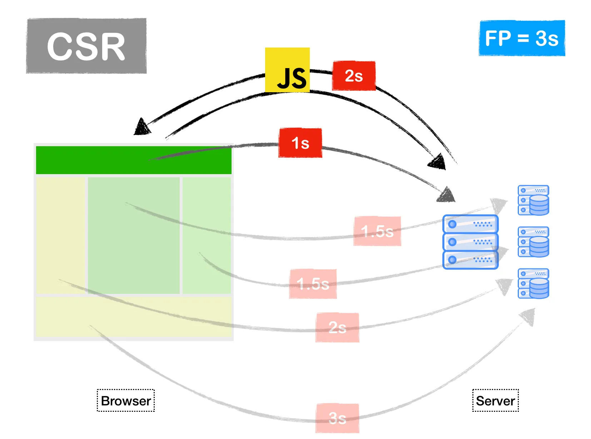

CSR的好处是部署简单，开发成本低，使用场景非常广泛。但带来的问题也很明显，页面中不论是静态渲染还是Server数据内容，都必须等到<strong>JS执行</strong>阶段才能渲染，渲染链路太长导致白屏时间也变长。

### 2.2 服务端渲染：SSR

<strong>SSR是在服务器上渲染整个 HTML 并将其发送到客户端的技术</strong>。 一个典型的SSR的工作流程：访问页面后，浏览器的请求会打到Server， Server在获取数据后渲染出相应的HTML，然后返回给浏览器。这样浏览器解析DOM之后，就能看到完整内容了。

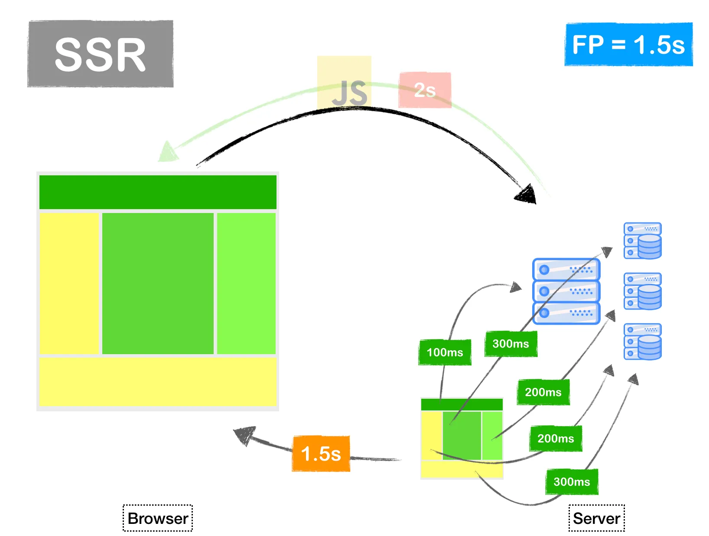

可以说在以前SSR才是真正的主流，例如JSP、ASP框架都是实现SSR的技术框架。但随着前后端分离、SPA框架的兴起，SSR逐渐被CSR所代替。随着时间的发展，CSR的缺点越来越明显，SSR又被重新搬回到了技术的舞台上，落实到以SPA框架为主流模式的现如今，SSR和早期已经发生了一些变化，更加细节的行为其实是下面这种叫“<strong>同构SSR</strong>”的渲染方式。

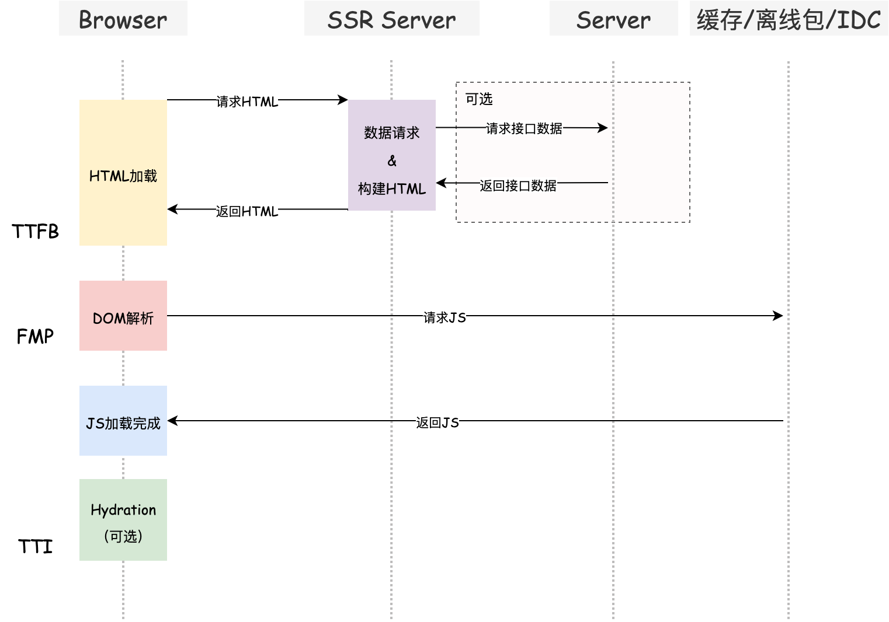

同构SSR是指：请求打到基于Node.js的SSR专用Server后，Server会通过前端产物执行同构代码，这个过程中Server会请求接口获取数据「可选」，然后生成 HTML 返回给浏览器。（特定场景下为了提高SSR构建HTML的效率，可能会选择生成页面中指定的一部分DOM）

此时浏览器可以先展示服务端生成的内容。依赖前端框架的交互通常还需要等待JavaScript加载和执行，再通过Hydration将静态DOM与客户端应用关联起来。

对于主要内容依赖JavaScript渲染的页面，SSR可以将内容展示提前到HTML解析阶段。实际收益取决于数据请求、服务端渲染、网络响应和客户端初始化等环节，应在相同业务与设备条件下测量。

同时基于HTTP能力，SSR生成的页面经过特殊处理能够利用上HTML流式加载的特性（下文中的SSG也同样可以利用上这个能力）：浏览器在收到部分HTML时就开始解析,而不是等待整个HTML文档从而渐进式地渲染页面，将页面渲染前置。下图展示了同一个SSR页面，在普通渲染和流式渲染两种方式展示上的区别：

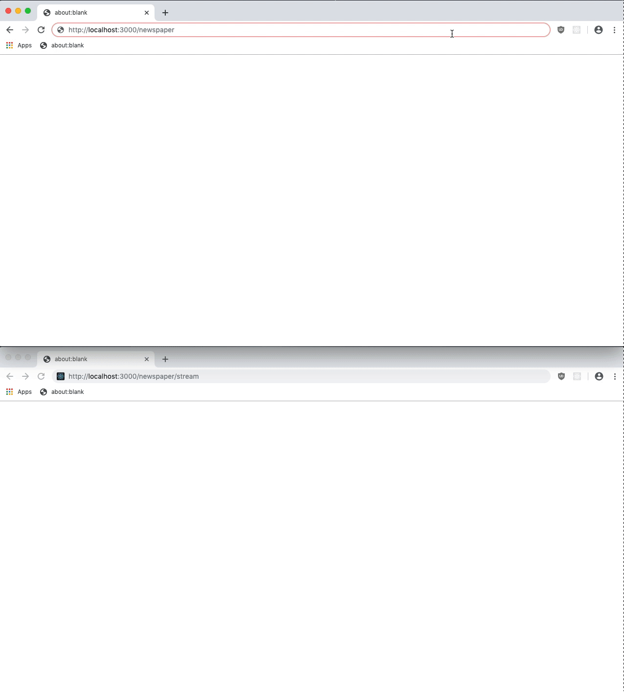

<strong>SSR也有请求时的服务成本。</strong>如果每次访问都需要查询数据并生成HTML，流量峰值会放大服务端压力。SSR页面能否使用CDN和浏览器缓存，取决于内容是否与用户关联，以及缓存策略和缓存键的设计；稳定、可共享的SSR响应同样可以缓存。

### 2.3 构建期预渲染：SSG

SSG将可展示HTML的生成提前到构建阶段，适合页面结构和公共内容相对稳定的场景。它可以使用服务端渲染器，也可以通过无头浏览器运行SPA并导出DOM。本文案例采用后者：构建时渲染通用页面框架，用户相关内容展示兜底UI，再输出静态HTML。

用户访问时，浏览器在解析HTML后就能展示页面框架。随后加载JavaScript，通过Hydration或独立挂载的方式完成交互初始化。它将首屏内容可见的时间前移；页面是否已经可交互，仍需要单独衡量。

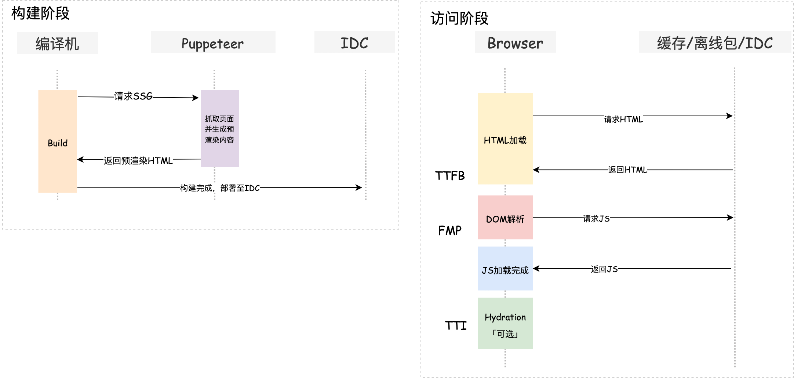

SSG也适用于文档、内容站等场景。以当时Vue文档站的访问记录为例，请求返回的HTML中已经包含了预渲染DOM：

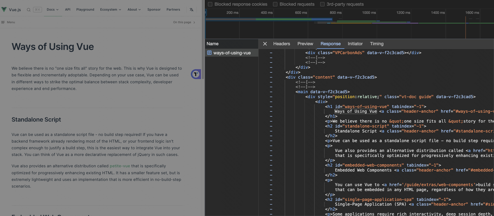

静态HTML便于配置CDN和浏览器缓存。下面的历史访问记录中，后续请求返回304，说明客户端保存的资源仍然有效，可以继续复用。<strong>304本身不能证明命中了CDN边缘缓存</strong>；判断CDN命中还需要结合Age、X-Cache等响应头或平台日志。

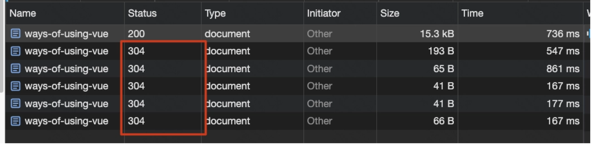

另一组历史SSR页面访问记录中，请求耗时约为400ms。两组记录来自不同页面，只能展示各自当时的访问表现。比较SSR与SSG的性能时，应尽量保持页面、数据、设备和网络条件一致，并区分首次访问与缓存命中场景。

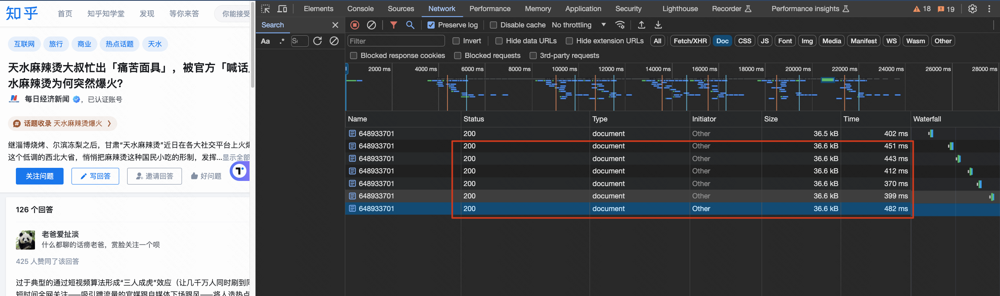

渲染方案需要结合业务选择。对于公共内容稳定、访问峰值明显的活动，SSG有助于降低请求时的渲染成本，并复用静态资源分发能力。对于实时性或个性化要求较强的页面，SSR仍有适用空间。预渲染也不会自动解决脚本体积、接口耗时和主线程阻塞等问题。

## 三、为什么选择SSG

### 3.1 活动背景

案例来自2024年的一次春节运营活动。页面头部包括主视觉动效、三个按钮位和一个集字区域，主题在初五零点从蓝紫色切换至橙红色：

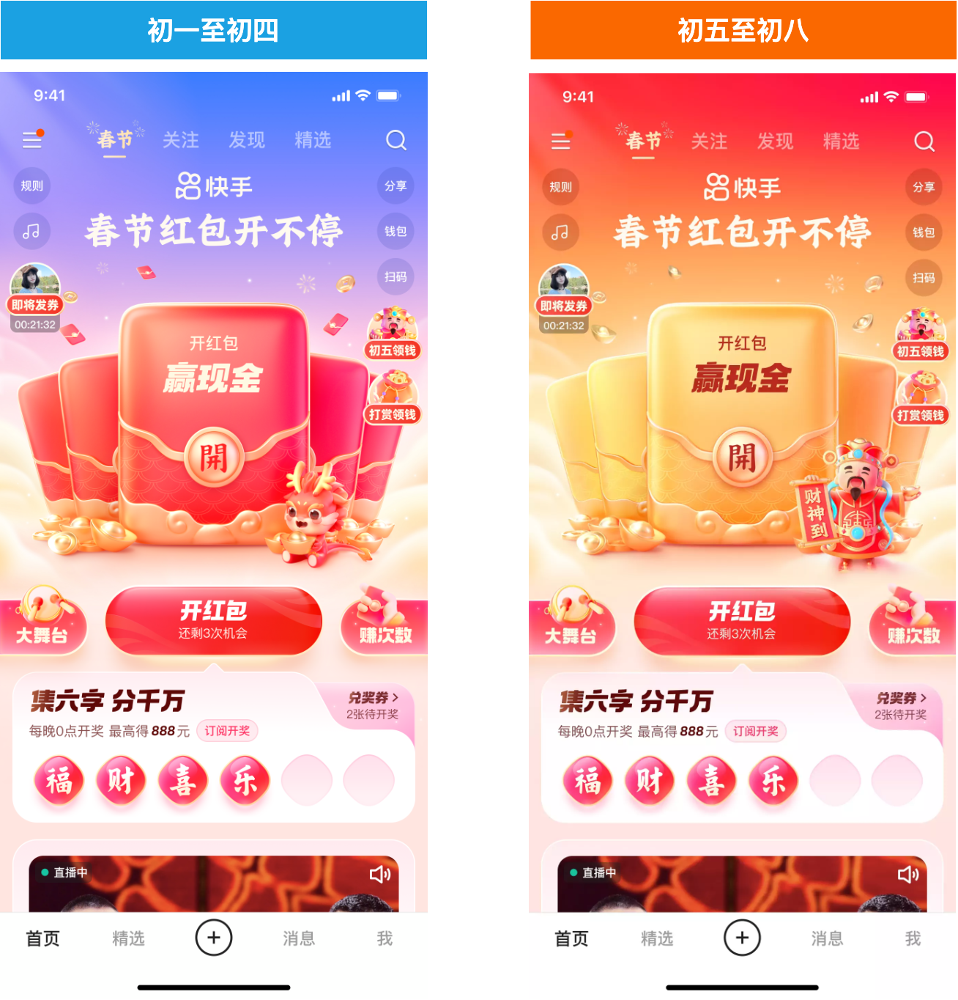

### 3.2 页面结构特性

在效果图中，进行简单拆解之后就能发现首屏的大部分内容其实都是静态、无需接口数据的，首屏部分通过SSG构建出一份让<strong>用户至少能够知道H5意图</strong>的预渲染页面，效果可以参考下图:

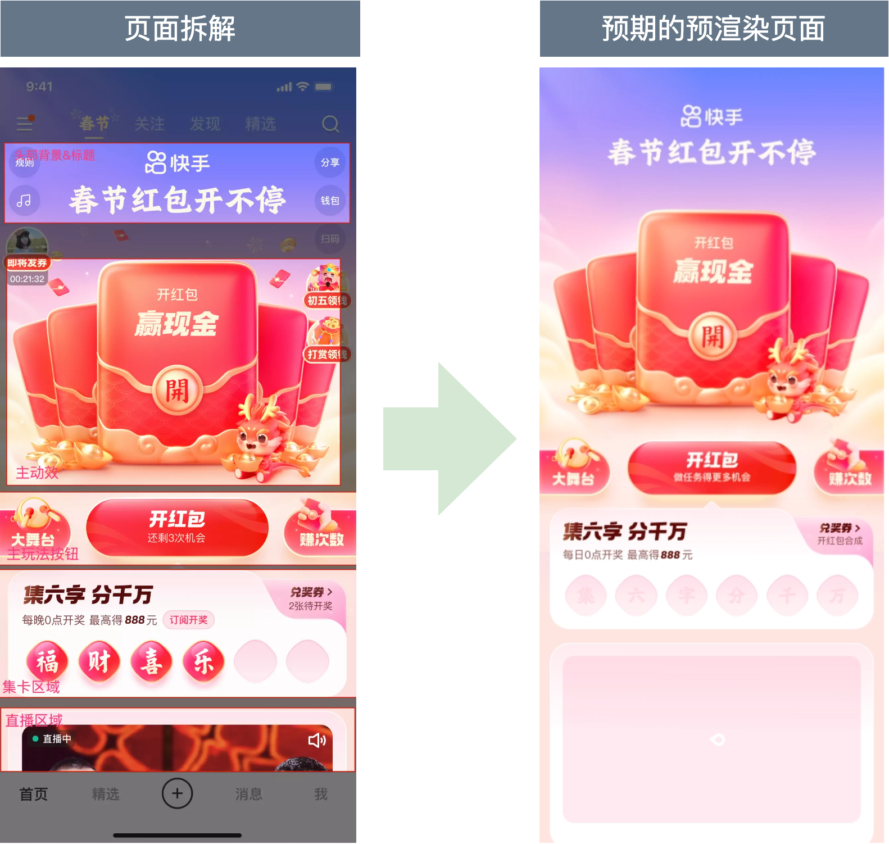

### 3.3 活动流量特性

大型运营活动通常具有活动周期短、流量波动大的特点，集中投放会进一步放大访问峰值：

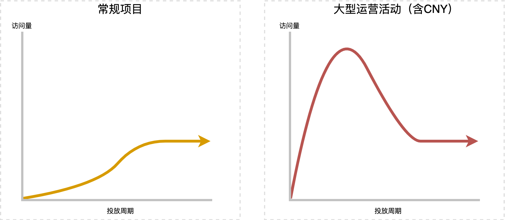

如果采用每次请求都生成HTML的SSR方案，需要为活动峰值准备相应的服务资源，并设计好个性化内容与缓存的关系。对于本例中较稳定的首屏框架，构建期生成HTML可以减少请求时的渲染工作；配合客户端离线包，还可以提前分发预渲染HTML和静态资源。

### 3.4 实现方案简介

<strong>基于首屏静态内容占比较高、流量峰值明显的特点，案例选择了构建期预渲染。</strong>预渲染内容让用户先理解页面用途，再由正式应用完成数据填充和交互初始化。相比只展示Loading，这种方式能更早呈现活动框架。

<strong>SSG构建方案</strong>

该项目基于Vite，因此通过一个构建插件（useSSG）组织预渲染流程：

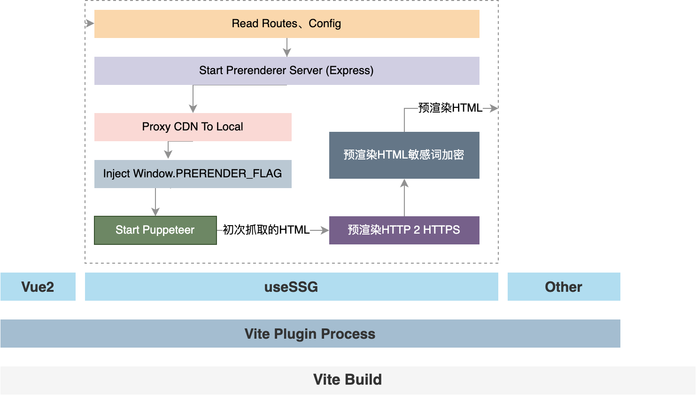

-   读取项目的基本配置，这其中包括了预渲染DevServer和无头浏览器的启动参数
-   启动预渲染DevServer，保证页面可以在编译机上可初步访问
-   由于上一步编译过程中，页面内的所有静态资源地址都会被替换为CDN地址，但实际在后面预渲染阶段我们的资源完全可以访问本地资源，因此在这里我们为DevServer设置了一层代理，将CDN的请求代理到本地
-   为页面注入一个<strong>全局的“PRERENDER\_FLAG”变量</strong>，如果当前页面为预渲染阶段时，各个模块会依赖这个变量去做特殊处理，例如在PRERENDER\_FLAG=true时，我们无需去请求各类业务接口、直播模块保持展示Loading等
-   启动Puppeteer无头浏览器，访问DevServer，并抓取预渲染HTML
-   接下来对抓取后的预渲染的HTML做初步处理，在部分情况下预渲染的html里会有http的链接，我们在这一步统一替换成https
-   对HTML做必要的内容处理与产物校验，确保资源引用和预渲染内容完整。
-   最终我们将预渲染的HTML生成完毕，SSG构建完成，编译机进入下一步流程

<strong>C端渲染方案概览</strong>

最初的方案是：先展示预渲染HTML，JavaScript加载完成后通过Hydration接管现有DOM。以Vue 2为例，可以在挂载根节点带有`data-server-rendered="true"`时自动进入Hydration，或通过`app.$mount("#app", true)`显式启用。实际项目还需要保证预渲染DOM与客户端初始结构匹配。

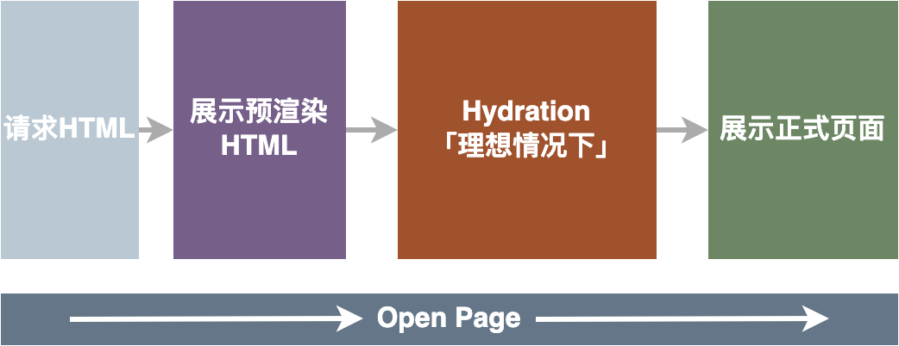

SSG的渲染流程以及于CSR的差异点如下图：

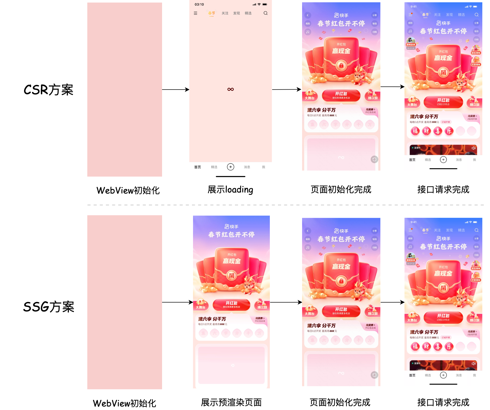

但最终事情走向真的这么简单吗 👀？最终方案其实在下文遇到的一个个问题中发生了一些有意思的变化，让我们接着往下看。

## 四、遇到的问题和解决策略

我们在实施SSG方案的过程中，也遇到了一些有意思的问题，这里和大家分享一下我们的解决方式和思路，希望能够帮助大家排雷~

### 4.1 Hydration的一致性要求与替代方案

> <strong>注：下文内容基于Vue2.7讨论</strong>

<strong>问题背景</strong>

Hydration在Vue中，它指的是Vue<strong>接管预渲染内容，使其变为由 Vue 管理的动态 DOM</strong> 的过程。在预期中，我们预渲染的内容可以通过Vue提供的Hydration能力无缝的切换至正式页面，在测试环境测试的过程中，我们也顺利达到了这个效果。但在页面上线后却吃了瘪：我们发现<strong>页面并没从预渲染完全切换至正式内容</strong>，有部分组件内容依然是预渲染的状态没有任何交互。

<strong>原因解析</strong>

排查时需要重点关注预渲染DOM与客户端初始虚拟DOM的一致性。比如构建阶段通过v-if隐藏复杂内容、运行时再根据接口数据展示，或两端列表数据不同，都可能造成结构不匹配。Hydration对这些差异的处理与框架版本有关，应使用真实生产构建进行验证。

Vue 2官方文档说明：开发环境会检查客户端虚拟DOM与服务端DOM是否匹配，不匹配时退出Hydration并重新渲染；生产环境为性能考虑会移除这项开发期断言。因此，开发环境中的回退表现不能直接代替生产验证。

本案例使用Vue 2.7，在正式构建中出现了部分内容仍停留在预渲染状态的问题。这个经验提示我们，应分别验证条件渲染、列表渲染及首屏数据准备的时序，而不能仅以测试环境能正常接管作为验收依据。

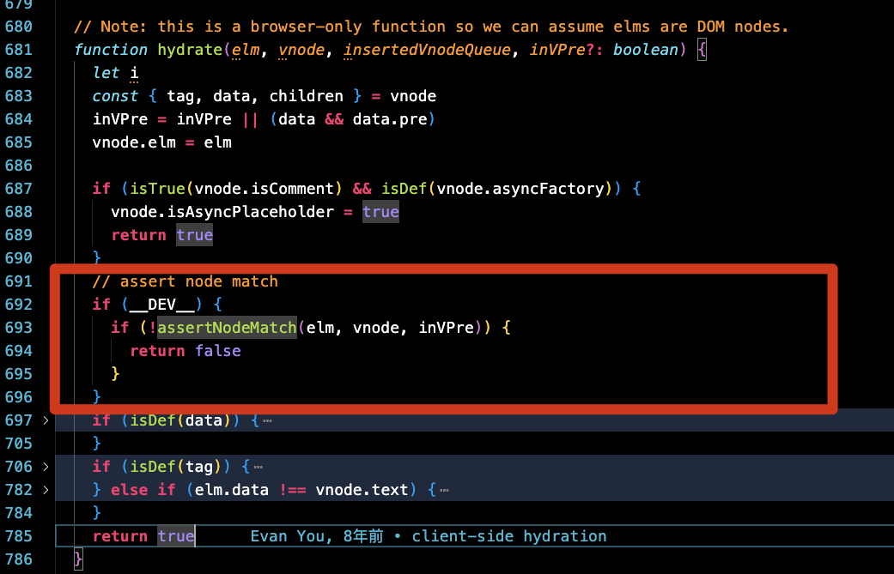

<strong>渐入“佳”境</strong>

知道了这个问题的原因之后，一开始我们的想法是尽量让预渲染DOM和VDOM保持一致，一个讨巧的办法是通过v-show去代替v-if，这样既可以保持DOM不变，又能做到视觉上的屏蔽。但随着时间的推移，我们发现v-for也产生DOM不匹配的问题，这个就不好通过上面这种方式解决，一时之间陷入了两难。

<strong>最终解题方式：偷梁换柱</strong>

案例最终采用了独立挂载的方式：<strong>保留预渲染页面（app\_ssg），在其上方创建正式应用（app），等正式应用完成首屏初始化后，再移除预渲染节点。</strong>

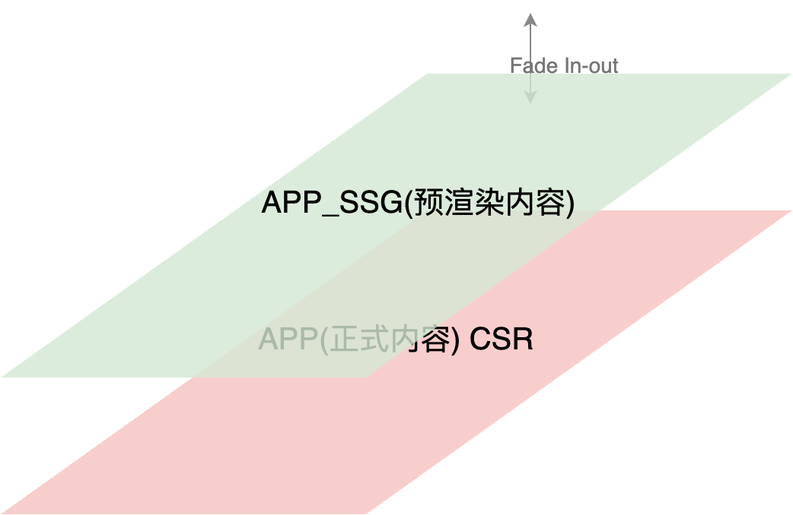

这个方法能够将预渲染和正式页面完全隔离开来，双方不再受Hydration的诸多限制。同时我们为app和app\_ssg做了淡入淡出的效果，使得预渲染切换至正式页面时拥有更丝滑的用户体验。

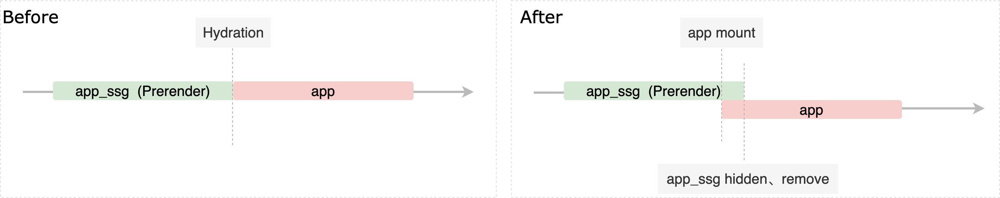

这让两份DOM相互独立，也带来了短暂的双份DOM和重新初始化开销。页面状态与动画需要额外衔接。是否采用这种方式，应结合首屏复杂度、内存占用以及框架已有的Hydration能力评估。

### 4.2 WebView适配

同一个活动页面可能被放入独立落地页、半屏弹层、直播间内嵌页和搜索入口等不同容器。容器形态变化会影响顶部栏高度、状态栏占位以及部分模块的显隐：

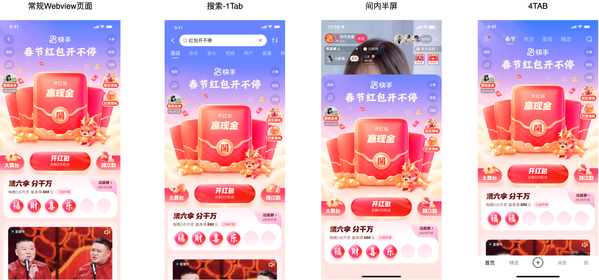

本例主要需要处理两类差异：

-   不同容器的顶部栏和安全区域高度不同。
-   直播间内嵌场景不再展示独立的直播区域。

假如说我们在构建阶段就已经生成并固定好了页面样式，这其中包括（顶部栏的高度、直播区域的显隐），就没有办法同时满足这四个资源位，同时在预渲染页面中还有一些需要通过UA OR Cookie中动态获取的数据，例如状态栏的高度。

为此，我们的解法是在预渲染构建的HTML中注入处理的JavaScript脚本（Pre-Adapter JS），这段脚本中，我们所做的事就是前置判断好当前的容器环境，并计算出响应的顶部栏高度、状态栏高度并反应在预渲染和正式渲染的页面CSS中，这样我们就可以在预渲染阶段将对应容器的适配做好：

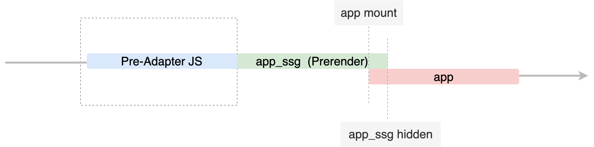

### 4.3 动效不同步问题

在活动页面的头部，有一个红包重复摇晃的动画。这个动画比较简单，是通过CSS实现的，所以这块内容我们是按预期写到预渲染页面里去。但在页面线上回测的过程中出现了这么一个问题：<strong>红包的摇晃动画从预渲染切换到正式页面后，会偶现闪烁的情况</strong>(为了能明显看到效果，录屏为0.3倍速)：

<strong></strong>

坦白来说，这个问题我们在测试环境并没有发现，甚至在线上回测初期也没有出现。想到这，我们内心突然出现了一个词：“离线包”，难道是命中了离线包导致的？回过味来之后突然想起来，由于使用了“偷梁换柱”的处理，预渲染和正式页面的红包明明是两个不<strong>同的DOM节点</strong>，动效的运行理论上也是独立的，好像本来就应该会出现闪烁的情况，之前没有出现反而才是有问题的。这个诡异的问题，促使我们做了一番探究...

<strong>原因思考</strong>

首先来看这个动效的轨迹参数：

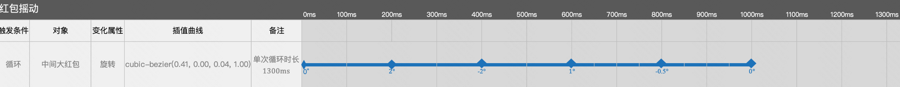

整个动效的时长为1300ms, 在0ms到1000ms之间会使红包在旋转角度在-2度 到 2度之间变化，后面1000ms到1300ms红包是处于不动的状态，也就是说如果在这个时间段内发生了由app\_ssg变为app的情况时，就不会出现闪烁的情况，因为本身红包的状态就没变化

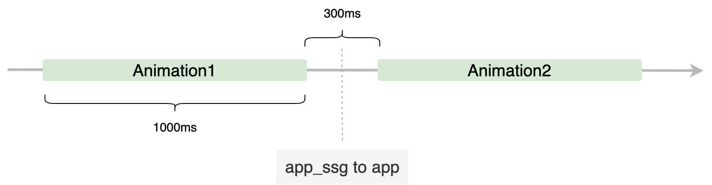

但理论上来说，在非首次访问有缓存的情况下app\_ssg 替换为 app的时机需要等到1s以后的概率是比较低的（替换时机：JS加载完成并执行），但是顺着这个思路我们突然发现了华点：人眼毕竟是人眼，在动效变化非常小的情况下人眼是不是没办法看太出来，比如旋转0.5deg 和 0deg，为了验证这个设想，我在这里模拟了一个动效角度小于等于0.5时，频繁切换DOM的[<u>Domo</u>](https://codepen.io/jackym06/full/VwNmGKw)，大家可以体验一下，实际观感确实没有明显感觉到闪烁。

接下来，我们将动效根据贝塞尔曲线和变换节点，将红包的渲染角度转化为散列图表（[<u>通过GSAP计算得到的60fps数据源</u>](https://codepen.io/jackym06/full/LYvbgWx)），如下图：

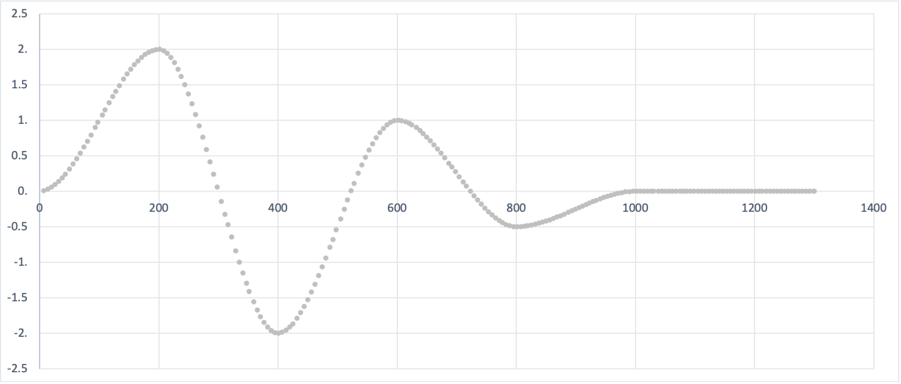

我们把这一整个动效的1300ms拆分，图中标记黄色的部分为动效角度变化 <= 0.5deg的部分，当动效在约<strong>670ms左右之后</strong>，将长期进入角度在0.5度以内的变化范围：

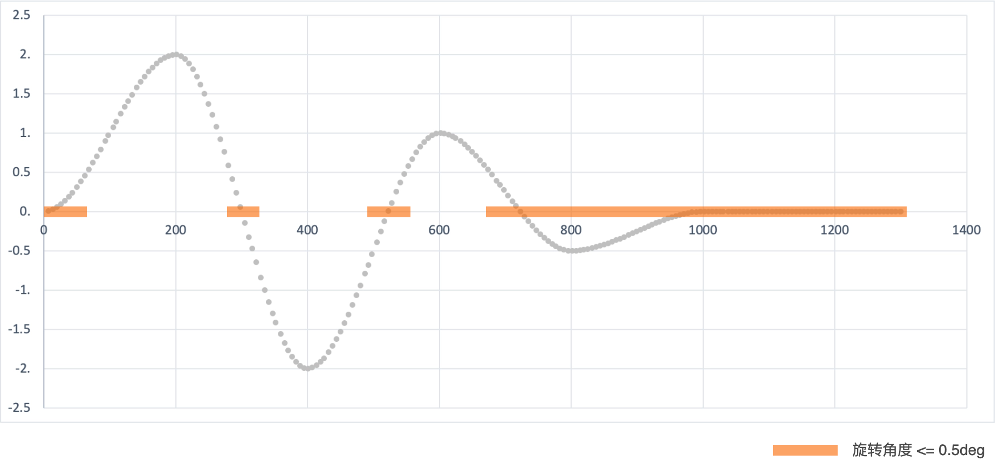

但670ms我们其实是不认可的，如果说在JS没命中缓存的情况下耗时在670ms+还能说得过去，但如果命中缓存还是这个耗时其实是不太合理的，所以这个推论<strong>并不完全正确</strong>。

继续对照录屏可以观察到：同样的角度变化，发生在动画回落区间时，比发生在持续增大区间时更不容易被察觉。这是对本例动效的观感分析，不能直接推广为固定的视觉阈值。

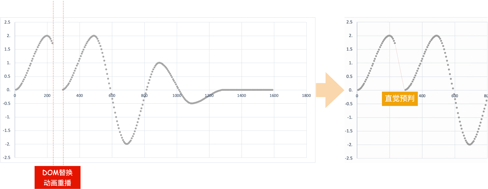

将替换时机与角度曲线放在一起分析，本例中相对不明显的区间可以提前到约250ms。下面的图展示了这次采样中标记出的回落区间：

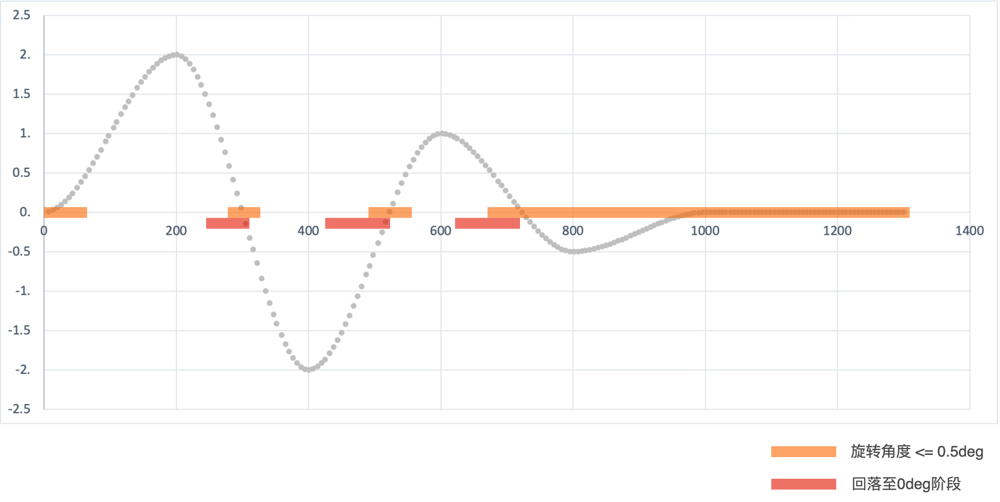

这里写了一个[<u>250ms进行动效重置的效果</u>](https://codepen.io/jackym06/full/qBwqQZx)的Demo来进行佐证：

事情到了这里，“<strong>闪烁问题为什么之前没出现，有了离线包之后却特别明显</strong>”的问题原因也逐渐清晰了起来：在有了离线包的加持后，app\_ssg替换到app的时机通常就在第一个区间（60ms  ~ 250ms）内，并且在这个区间内角度是逐渐变大的，所以如果在此时移动动画被重置，看起来就会特别明显。

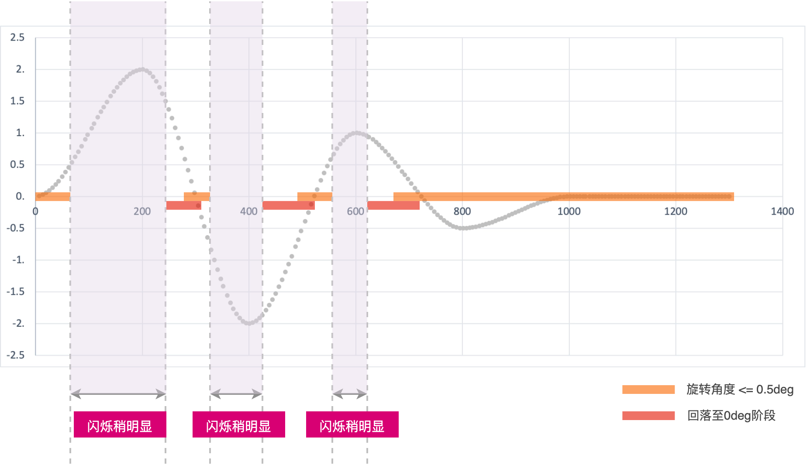

<strong>问题解法</strong>

知道原因后，我们接下来的目标就是：尽量让正式页面的动效继续沿着预渲染页面的动画轨迹进行播放。

假设这个动效是通过视频实现的，那么这个问题就很好实现，我们将预渲染的动效进度记下来，切换到实际页面后，在将动效的进度切到预渲染记录的进度继续开始播放。 但由于之前并没有对Animation做过细粒度控制的经验，我们尚不清楚CSS动效是否存在类似视频“进度”的概念，如果存在是否能支持设置类似视频的currentTime, 从而达到修改进度的效果？

通过调研，浏览器实际上提供了一组Animation  API, 只要DOM上含有动效，就可以通过getAnimations 方法获得这个动效的Animation 对象。对象中有两个关键属性：

-   `currentTime`：动画当前的时间位置，单位为毫秒，时间未确定时可能为null。
-   `startTime`：动画在所属时间线上的起始时间，未确定时为null，并非Date.now()形式的墙上时钟时间。

当两边动画使用相同配置和时间线时，可以复用有效的startTime，或依据currentTime对齐进度。本例在初次尝试同步时，出现过动画没有正常播放的情况：

经过debug我们发现，从预渲染DOM获取的动效startTime并没有预期返回时间戳，而是<strong>返回了null</strong>。回过头来我们又去翻了一遍api文档，原来是有这么一行被我们忽视了：

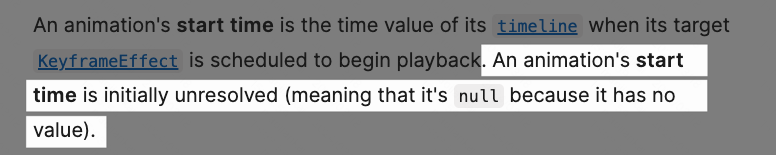

动画的起始时间尚未确定时，startTime可能为null。如果未经判断就将它赋给正式页面的动画，会破坏预期的播放状态。案例中的录屏也显示，在发生问题时，预渲染动画还没有开始播放。

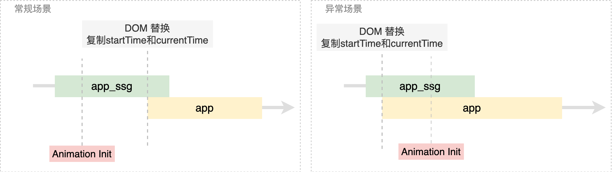

之所以我们没在本地和测试环境中发现，是因为这两个环境没有离线包，而线上是有离线包的，因此返回JS的速度很快，替换的时机也很早。最终我们在复制前<strong>对预渲染的startTime进行了前置判断，如果是非null的情况下才赋值给正式页面</strong>，从而解决了这个问题，效果如下： 

### 4.4 初五换肤问题

<strong>问题背景</strong>

大家如果稍微留意前面的内容，就会知道活动页面其实会在初五的时候将页面主题色换至橙色。但是我们在SSG构建预渲染页面的时候显然是在活动前，也就是蓝色主题。如果我们不做任何处理，就会在初五出现异常的蓝色预渲染闪烁：

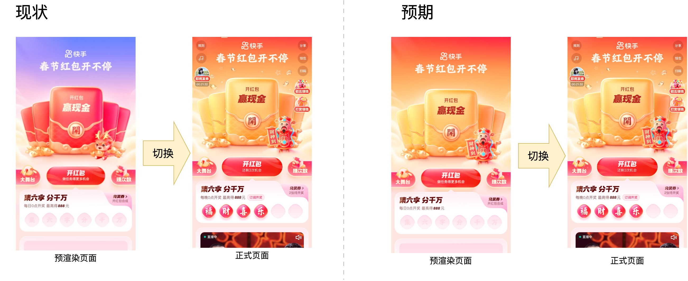

<strong>第一种解决方案</strong>

如果从构建的角度出发，我们可以在事先构建两套的预渲染页面（常规版和初五版），然后设置一个定时任务或者人工操作，当时间进入初五0点后，将流量全部切到初五版的渲染页面上。

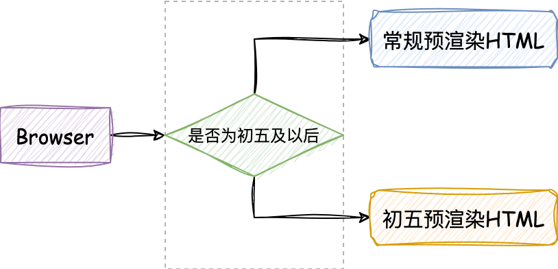

但是这种方式带来的问题也是很明显的，一方面初五的预渲染页面没有办法利用用户之前访问过的页面缓存，另一方面流量切换的成本也非常的高，而且容易出现一些问题。

<strong>第二种解决方案</strong>

考虑到换肤后的样式差异实际上不算太大，所以我们最终用了另一种比较讨巧的方式来解决换肤问题：

在Webview适配中提到的前置JS适配逻辑中，我们加入了对换肤条件的判断：判断当前时间是否为初五及以后，如果是的话为页面设置一个特殊的CSS类。同时，我们提前将初五的预设样式注入到页面中，这样就可以在初五的时候，预渲染页面自动切换到初五主题。

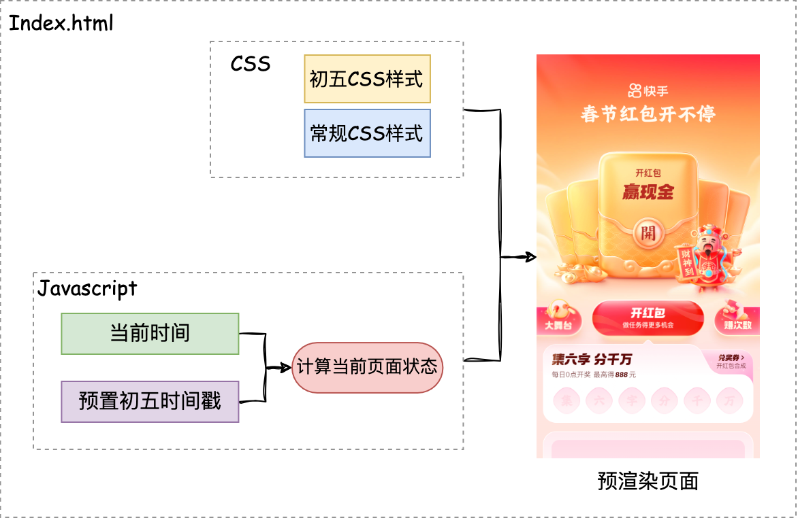

本例两套主题的样式差异较小，因此选择了前置脚本配合预设CSS的方案。这样可以复用同一份HTML与缓存，减少切流和缓存预热的工作。对于需要严格按时切换的活动，还应考虑客户端时间偏差以及兜底策略。

### 4.5 多路由项目下的SSG

我们的项目下，除了有主会场页面之外还有一个中奖名单页面，也就是多路由项目。由于我们在构建时只对主页生成了预渲染HTML，如果我们打开中奖名单时依然会展示主页的预渲染内容，这样就会造成了特别奇怪的闪烁：

在另一个多场次活动中，不同场次复用相似的页面布局和功能，但都有独立入口、且同样重要。针对这种情况，可以<strong>为每个主要路由分别生成预渲染HTML</strong>，避免入口与首屏内容不匹配：

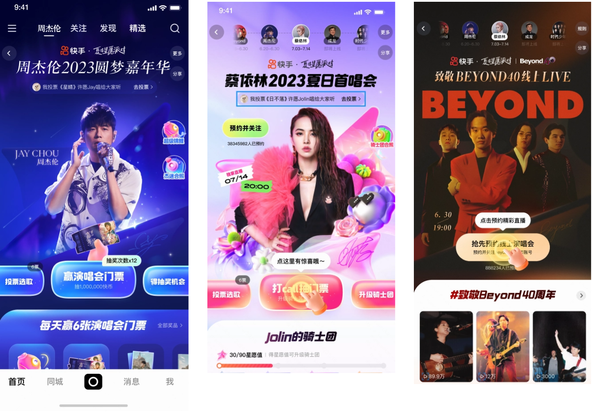

回到本案例，中奖名单是访问量较低的二级页面，因此采取较轻的兜底方式：<strong>在Pre-Adapter脚本中识别当前Path，如果进入中奖名单，就先隐藏主页的预渲染DOM，展示Loading，等待对应路由的正式内容就绪。</strong>

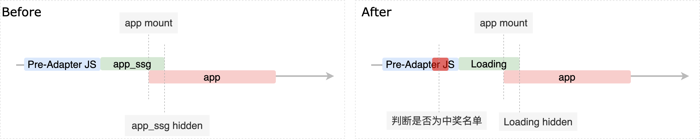

## 五、总结

对于首屏公共内容较多、流量峰值明显的大型运营活动，构建期预渲染是一种值得评估的首屏优化方式。这个案例中，真正需要持续打磨的是构建产物与运行时环境之间的衔接：

-   构建阶段提供稳定的页面框架，并为用户数据设计合理的兜底UI。
-   通过前置适配处理容器、主题和路由差异。
-   在正式应用接管时验证DOM、数据和动画的连续性。
-   覆盖首次访问、浏览器缓存、离线包命中以及低端设备等场景。

评估效果时，应同时关注首屏内容可见时间、FCP、LCP和关键交互就绪时间，并对不同访问场景分组比较。预渲染把内容展示提前，后续脚本、接口与交互性能仍需要继续优化。具体收益应以同一业务的对照测试为准。

## 参考资料

-   [Vue：SSR与SSG](https://vuejs.org/guide/scaling-up/ssr.html)
-   [Vue 2：客户端Hydration](https://v2.ssr.vuejs.org/guide/hydration.html)
-   [MDN：Animation.startTime](https://developer.mozilla.org/en-US/docs/Web/API/Animation/startTime)
-   [MDN：304 Not Modified](https://developer.mozilla.org/en-US/docs/Web/HTTP/Reference/Status/304)
