

## 地库遛弯时的思考

一次在地下车库散步时，停放着的各种汽车让我产生了好奇：车上的摄像头和雷达越来越多，它们各自负责什么？自动驾驶系统又如何把这些输入转化为方向和速度？这篇分享便从这些问题开始。

过去多年，AI持续改变着汽车的感知与决策方式。本文沿着早期赛事、模块化架构、BEV表征、端到端与VLA这条线索，介绍技术演进中的关键问题。这里讨论的是架构思路，具体系统的自动化等级和适用条件仍需要分别判断。

这些问题引起了我的好奇，今天这篇文章就尝试分享一下自动驾驶的发展历程，看看都说自动驾驶难，那它到底难在哪？

## 早期自动驾驶的探索

### 从一次失败开始看起

理解这段历史，可以从2004年的DARPA Grand Challenge看起。比赛路线约142英里（约229公里），15辆参赛车辆中没有一辆完成全程。卡内基梅隆大学的Sandstorm行驶了7.4英里，约11.9公里，是当届走得最远的车辆。根据参赛团队当年的[公开回顾](https://www.cs.cmu.edu/news/2004/carnegie-mellons-red-team-sandstorm-robot-sets-distance-record-darpa-grand-challenge)，它最终在道路边坡处受困并损坏了传动部件。

为什么会这样？

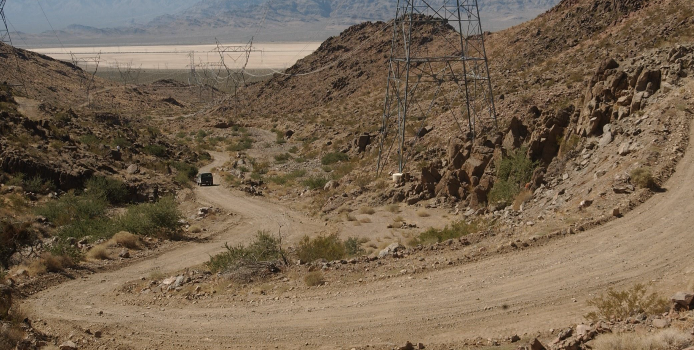

### 最初的技术结构

一个直观的起点是：为车辆提供目标位置和路线信息，再通过定位、环境感知和控制，让车辆沿合适的路径前进。真实道路中的难点在于，车辆还要持续识别可通行区域、障碍物及地形变化，并据此修正决策。

在越野比赛中，仅有路径点也不足以保证通行。车辆需要判断当前位置附近哪里能走、哪里有障碍，以及何时转弯或绕行。这使环境感知成为早期系统的重要挑战之一。

不同传感器提供的信息互补：摄像头擅长获取纹理、颜色和语义，但从二维图像恢复距离需要额外估计；激光雷达可以直接提供空间距离信息；超声波传感器通常用于近距离探测。它们都受安装位置、量程、天气、遮挡和算法处理方式影响，不能仅凭某一项硬件参数判断整套系统的能力。

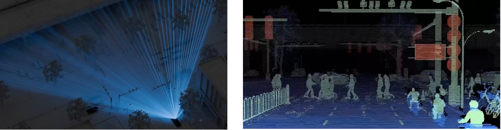

这类比赛暴露的是一整套系统的工程约束，包括传感器能力、地形建模、规划控制与车辆状态。仅用传感器价格或扫描频率解释某一次失败，会遗漏重要背景。

到2005年的第二届DARPA Grand Challenge，已有五支队伍完成赛程。这说明系统工程、算法与硬件的迭代可以带来明显进展，也为后续自动驾驶研究提供了实践基础。

### 模块化自动驾驶

在随后广泛采用的模块化架构中，常见的职责划分包括：

-   定位模块
-   感知模块
-   规划模块
-   控制模块

定位决定当前在哪，感知决定当前有什么，规划则根据定位和感知做出下一步的决策，最终交给控制模块来控制方向和速度。

## 如何认识世界

距离信息可以帮助判断物体在哪里，视觉信息则有助于判断它是什么。激光雷达同样可以参与目标识别，但多类传感器如何表达、融合和验证信息，依然是一个独立问题。先从视觉识别的方法变化看起。

### 早期特征识别的局限性

早期视觉方法经常依赖人工设计的特征。例如物体边缘、纹理，以及局部亮度变化，都可以成为分类器的输入。

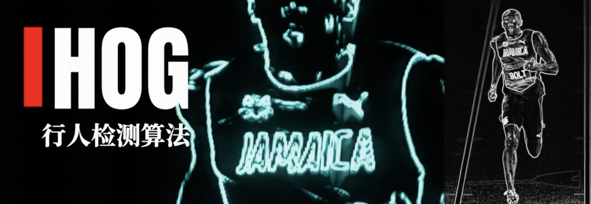

HOG（方向梯度直方图）就是一种代表：它统计局部图像梯度的方向分布，配合分类器进行行人等目标的检测。

人工特征具有可解释、计算代价可控等优点，但在复杂姿态、光照、遮挡和目标类别变化下，需要持续设计特征与训练分类器，泛化能力也会受到限制。

### 纯视觉的转机

2012年的AlexNet是深度视觉模型发展中的重要节点。[原始论文](https://papers.nips.cc/paper_files/paper/2012/hash/c399862d3b9d6b76c8436e924a68c45b-Abstract.html)展示了卷积神经网络在大规模图像分类上的效果提升。这里更值得关注的是方法变化：

-   人工特征方法：由工程师设计有用的特征，再训练或配置识别器。
-   深度学习方法：通过数据与训练，让模型学习适合任务的多层特征表示。

不同数据集上的Top-1、Top-5、分类准确率与检测指标不能混为一个“识别成功率”。视觉模型的进步也不意味着低照度、恶劣天气和遮挡等问题已经解决。

### 高精地图的入局

高精地图提供了另一种补充：提前采集道路几何、车道拓扑和交通设施等信息，再结合车辆定位，为感知与规划提供先验。

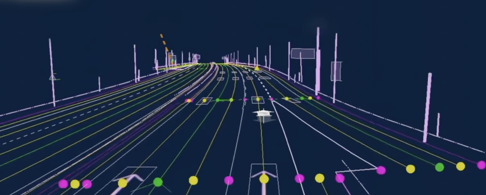

高精地图需要持续采集、维护与更新。成本、覆盖范围和道路变化带来的时效性问题，会影响它的使用方式；具体精度与更新频率依赖地图产品和地区，不能用固定的价格或周期概括。

地图先验能够补充车端感知，但车辆仍然需要处理临时施工、异常障碍物和其他动态变化。地图覆盖与系统是否适合在某处启用，是两个需要分别验证的问题。

2018年的一起测试事故进一步说明：安全不能只看某个感知模块的检测结果，还取决于目标跟踪、预测、制动策略和人员监督。

### 一次事故中的系统性教训

2018年3月，Uber的一辆自动驾驶测试车在美国亚利桑那州坦佩市撞上了一名推着自行车横穿道路的行人，造成行人死亡。

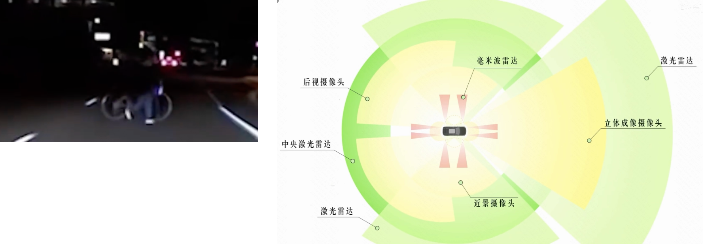

根据[NTSB的调查](https://www.ntsb.gov/investigations/Pages/HWY18MH010.aspx)，系统在碰撞前5.6秒已经检测到目标，但未能准确地将其分类为行人并预测其路径。测试系统还禁用了用于减轻碰撞的自动紧急制动，依赖安全员介入。

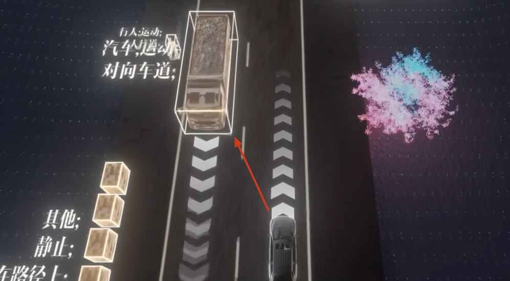

调查还指出，安全员因手机分心而未能持续监督，是事故的可能原因；风险评估、人员监督与安全文化等问题也参与其中。感知到一个目标，与及时采取安全动作之间，还隔着跟踪、预测、决策和制动等环节。

因此，讨论多传感器系统时，需要关注各模块如何处理不确定性和异常状态，以及系统在判断不可靠时采取什么措施。

这一案例不能简单归结为“雷达优先级高于摄像头”或某一种融合方式。更有价值的启示是：感知、规划、控制和安全保障必须作为整体来验证。

### 融合的不同层次

多摄像头系统还有一个常见问题：同一个目标可能跨越多个视角，分别识别后再合并结果，会增加关联和一致性处理的难度。于是，研究者开始探索在统一空间中融合多路输入，让后续任务共享信息。

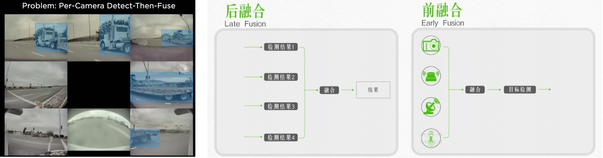

BEV（Bird’s-Eye View，鸟瞰视角）是一种常用的空间表达。传统环视系统可以把相机画面投影到俯视平面；面向行车的BEV感知，还需要处理物体高度、遮挡、深度误差与动态目标等问题。

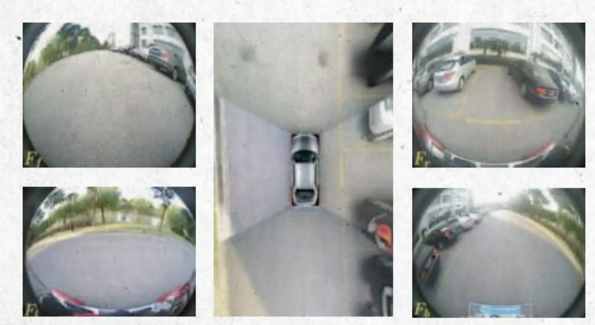

直接处理多路高分辨率图像，需要在精度、延迟、内存和功耗之间取舍。具体开销取决于分辨率、帧率和模型实现，不能脱离这些条件，用一个固定的TOPS数字判断某条技术路线是否可行。

特征级融合提供了一种常见选择：先提取各路输入的特征，再映射到统一的BEV表征中，供检测、地图理解或规划等任务使用。多传感器也可以采用类似思路，但仍需要处理标定、时间同步、遮挡与不同模态之间的差异。

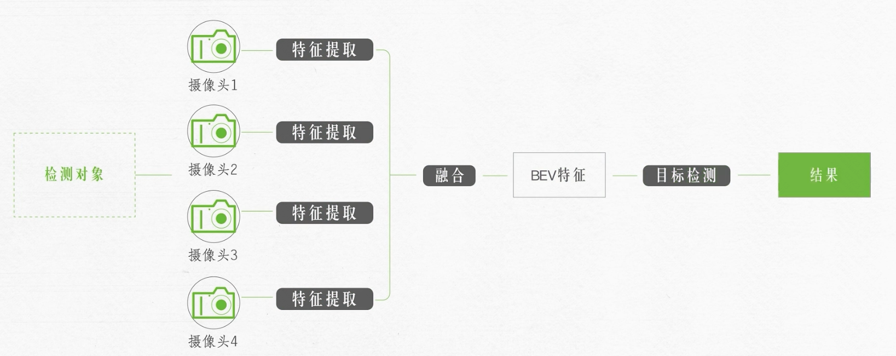

### 特征级融合

2020年的[Lift, Splat, Shoot（LSS）](https://research.nvidia.com/labs/toronto-ai/lift-splat-shoot/)提供了一种代表性方法：为图像特征估计离散的深度分布，将它们提升到三维空间，再聚合到BEV网格中。这里的深度是模型学习到的分布，并不要求先得到一幅完全准确的逐像素深度图。

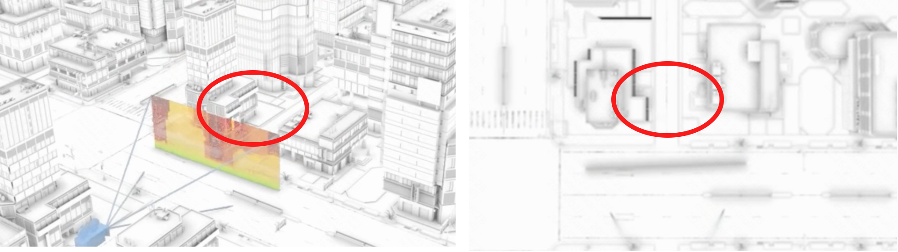

深度估计和几何映射的误差会影响BEV表征的质量。与此同时，数据、训练目标和聚合方式也会影响最终效果，这推动了后续多种BEV方法的发展。

### BEVFormer与注意力机制

[BEVFormer](https://arxiv.org/abs/2203.17270)是Zhiqi Li等研究者于2022年发表的工作，使用时空Transformer从多摄像头图像学习统一BEV表征。空间交叉注意力负责从相关视角聚合特征，时间自注意力负责融合历史BEV信息。

要直观理解这类方法，可以先提出一个问题：对于BEV网格中的某个位置，哪些相机、哪些图像区域可能提供有用的信息？

可以借用“先提出待查询的位置，再到图像特征中寻找证据”的类比理解Query机制。这个比喻帮助解释信息组织方式，并不等同于对人类认知机制的描述。

一个空间网格提供了组织信息的参考框架；模型通过学习，决定从输入中的哪些位置聚合特征，以及如何结合历史信息。

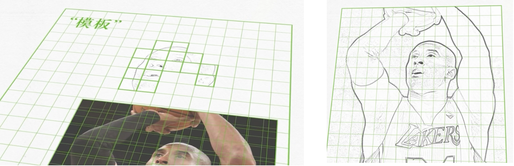

LSS与基于注意力的方法提供了不同的建模路径。下面的历史图示包含不同BEV架构的概念，主要用于说明图像特征、空间查询和信息聚合之间的关系，具体实现应以各自论文为准：

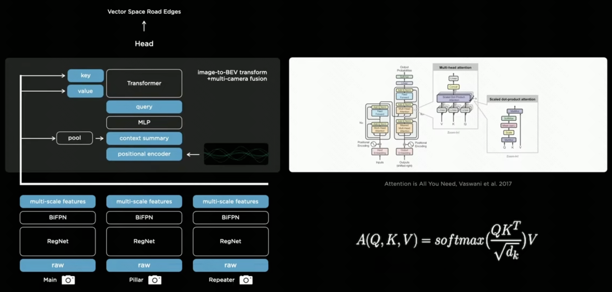

首先，由图像骨干网络提取特征。骨干网络可以采用CNN或其他结构，具体选择依赖模型设计；这些特征为后续的空间关联提供输入。

然后，为BEV网格设置查询。模型根据查询对应的空间位置，从相关相机视角中聚合特征，逐步形成BEV表示。

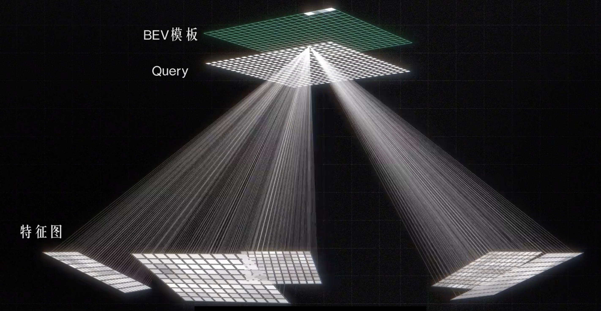

这种描述适合作为直观入门。实际计算还会涉及位置编码、相机几何、注意力采样和时序对齐等细节。

BEVFormer的实际效果预览：

<figure class="article-video" style="margin:24px 0"><video controls="" playsinline="" preload="metadata" style="display:block;width:100%;height:auto" aria-label="BEVFormer官方演示"><source src="/media/ai-autonomous-driving/bevformer-demo.mp4" type="video/mp4">浏览器暂不支持内嵌视频，请访问下方项目链接。</video><figcaption style="font-size:0.85em;color:#666;text-align:center">BEVFormer官方项目演示 · <a href="https://github.com/fundamentalvision/BEVFormer" target="_blank" rel="noopener">查看项目与出处</a></figcaption></figure>

### 更进一步：时空融合

单帧图像只描述一个时刻，引入历史帧可以帮助理解被暂时遮挡的物体和运动状态。BEVFormer通过时间自注意力融合历史BEV信息，论文中也报告了对速度估计等任务的改善。历史特征如何与当前车辆坐标系对齐，是时序融合中的重要问题。

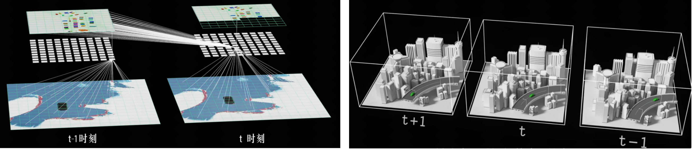

## 破土而生：端到端

### 无图规则时代

感知能力的提升，使一些系统能够在不依赖高精地图的情况下构建局部道路理解，再据此进行规划。这里的“无图”通常指减少对高精地图的依赖，系统仍可能使用导航路线或其他地图信息。

传统规划系统通常组合规则、搜索、优化和预测等方法。它需要处理交通信号、让行、绕障等大量条件；随着场景变复杂，规则交互和边界情况的维护难度也会增加。

长尾场景出现频率低，却可能包含较高风险。挑战在于如何获取足够的数据、构造有效测试，并让系统在不确定时保持合适的行为。

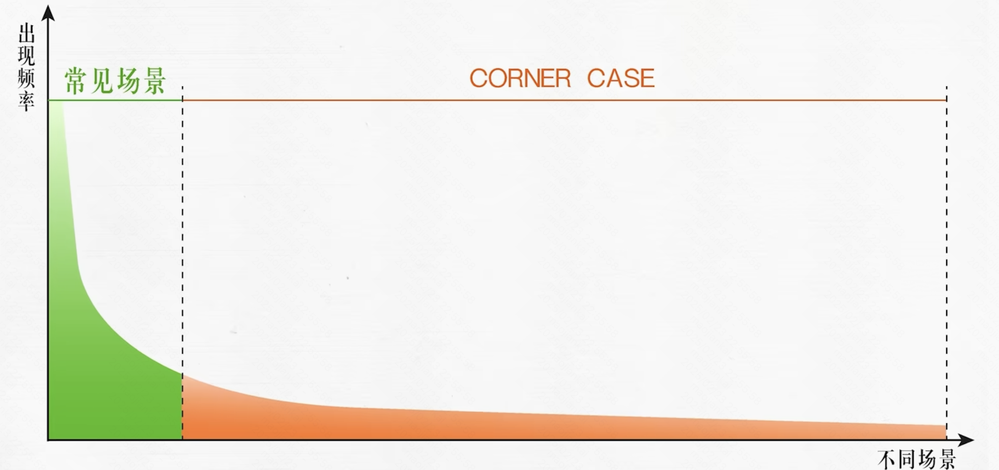

### 端到端（End To End）

端到端驾驶的研究早于近年的量产方案。例如NVIDIA在2016年发表的[End to End Learning for Self-Driving Cars](https://arxiv.org/abs/1604.07316)，研究了从摄像头图像直接预测转向指令的神经网络。不同系统对“端到端”的覆盖范围并不完全相同，可以是感知到规划，也可以进一步涉及控制输出。

这类方案尝试从驾驶数据中学习观测与动作之间的关系。例如面对前方停着的车辆，模型需要综合车道边界、对向来车、可通行空间和行为约束，给出合适的轨迹或动作。模型是否学到了可靠行为，需要通过验证来判断。

当系统在某些场景中表现不足时，可以通过数据收集、标注、训练与回归测试继续迭代。数据覆盖、训练目标和评测质量，都会影响这个循环的效果。

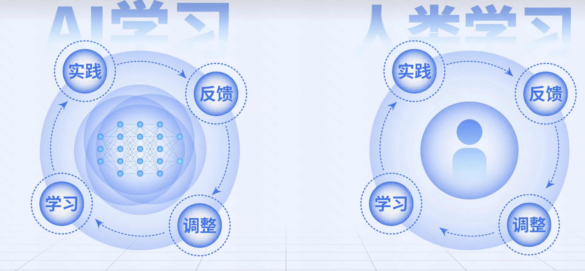

把多个任务连接起来，会增加训练、部署和验证的复杂度。实时计算、异常处理、数据分布变化与安全机制，都需要与模型设计一起考虑。

在分别训练的串行模型中，上游输出的误差可能被下游放大。联合训练与共享特征，试图让不同任务围绕共同目标协作：

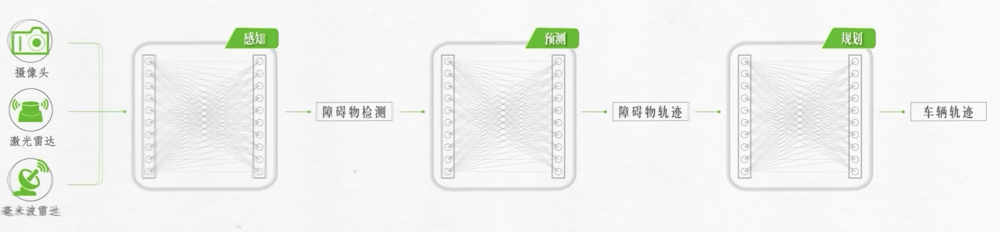

BEV可以作为共享中间表征，但端到端方法并不要求必须使用BEV。对于可微的模型部分，联合训练时可以通过损失函数和反向传播更新参数；推理时则使用已经训练好的参数，不能把它理解为车辆每一帧都会自动反向纠错。

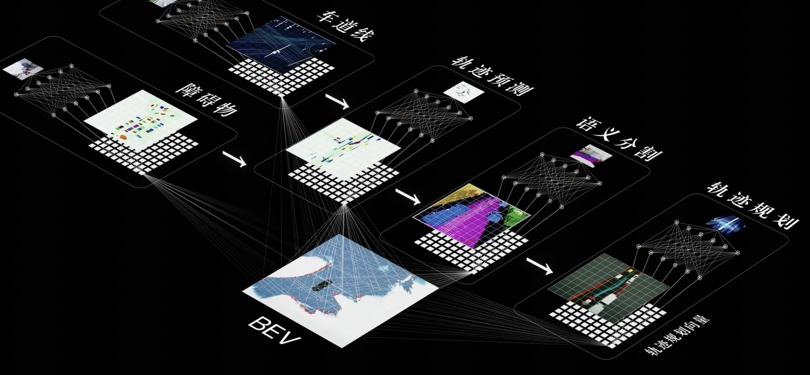

### 快模型与慢模型

为某类场景补充数据后，也需要确认其他场景的行为没有退化。长尾覆盖、数据平衡和回归验证，是数据驱动系统持续迭代的重要工作。

一种探索方向是分层协作：高频运行的模型负责实时轨迹或动作输出，另一类模型以较低频率提供语义理解、场景推理或高层约束。具体系统可以有不同分工；如何对齐时序、控制延迟，并处理推理不确定性，需要单独设计。

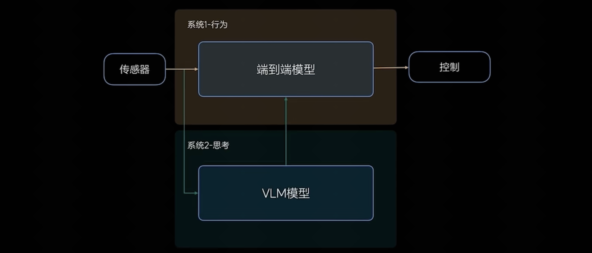

### VLA

在端到端与分层方案之外，Vision-Language-Action（VLA）也是一个受到关注的研究方向。

它关注如何把视觉观测、语言条件与动作学习连接起来，而不同研究在输入、输出和训练方法上可能有很大差异。

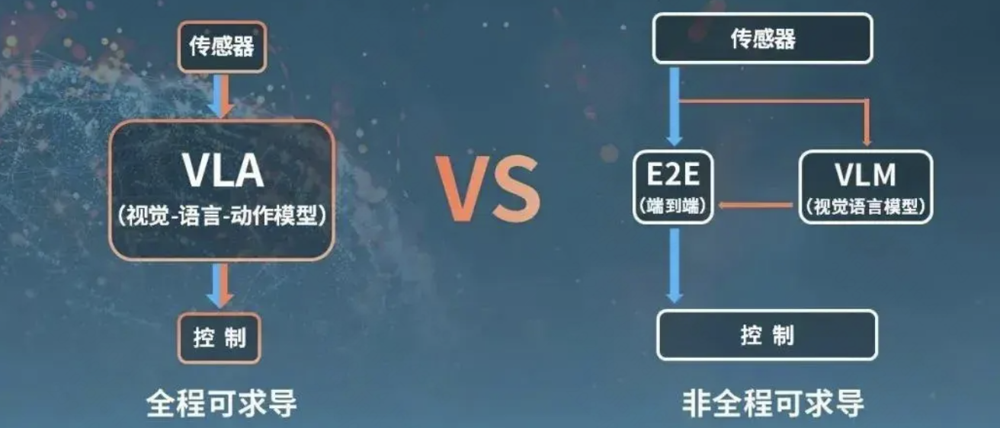

VLA的常用全称是<strong>Vision-Language-Action</strong>。以机器人领域的[OpenVLA](https://openvla.github.io/)为例，模型结合图像与语言指令，预测可以解码为连续控制量的动作。动作既可以出现在训练数据和历史上下文中，也通常是模型要生成的输出。

BEV是一种空间表征，端到端描述的是任务连接或训练方式，VLA强调视觉、语言与动作的联系。它们讨论的维度不同，实际系统可以组合使用。对于驾驶任务，语言理解能力还需要与车端实时性、动作约束和安全验证结合起来。

模型能否在车端部署，需要综合考虑参数规模、数值精度、内存带宽、功耗和任务频率。芯片标称TOPS会受计算口径影响，单个算力数字不能直接证明一套模型已经满足部署要求。

## 未来仍需解决的问题

自动驾驶技术的演进，与AI在感知、表征和决策学习上的发展紧密相连。从人工特征到深度学习，从单模块输出到时空融合和联合训练，系统能够利用的信息和建模方式都在变化。

技术路线的进步，需要用可重复的测试和实际运行表现来验证。量产车上的L2级辅助驾驶仍要求驾驶人持续监督道路与系统；有关等级的区别可参阅[NHTSA的自动化等级说明](https://www.nhtsa.gov/vehicle-safety/automated-vehicle-safety)。架构名称与无人驾驶能力之间，不能直接画等号。

## 参考资料与延伸阅读

### 论文与公开资料

-   [CMU：2004年Sandstorm参赛回顾](https://www.cs.cmu.edu/news/2004/carnegie-mellons-red-team-sandstorm-robot-sets-distance-record-darpa-grand-challenge)
-   [DARPA：Grand Challenge历史](https://www.darpa.mil/about/innovation-timeline/grand-challenge)
-   [AlexNet原始论文](https://papers.nips.cc/paper_files/paper/2012/hash/c399862d3b9d6b76c8436e924a68c45b-Abstract.html)
-   [NTSB：2018年坦佩测试车事故调查](https://www.ntsb.gov/investigations/Pages/HWY18MH010.aspx)
-   [Lift, Splat, Shoot项目页](https://research.nvidia.com/labs/toronto-ai/lift-splat-shoot/)
-   [BEVFormer论文](https://arxiv.org/abs/2203.17270)与[官方实现](https://github.com/fundamentalvision/BEVFormer)
-   [End to End Learning for Self-Driving Cars](https://arxiv.org/abs/1604.07316)
-   [OpenVLA项目页](https://openvla.github.io/)

### 延伸观看与讨论

-   [所长Wy：【深度解析】智能驾驶烧了1000亿，发生了什么？](https://www.bilibili.com/video/BV1wWfDYiEUi/)
-   [硬件茶谈：全自动驾驶离我们还有多远？端到端能让我们迈向自动驾驶吗？](https://www.bilibili.com/video/BV1JxBrYDETG/)
-   知乎讨论：[509207308](https://zhuanlan.zhihu.com/p/509207308)、[580193232](https://zhuanlan.zhihu.com/p/580193232)
