

## 前言

由于在工作中经常遇到有运营同学问一些视频相关的问题，恰好对于这一块也没有仔细的了解过，因此带着好奇心，去探索了一下视频的的生成过程。

本文将从视频成像开始讲起，中间会涉及：成像、图像处理、视频编码（最重要）以及最终的视频封装：

1. 「25%」相机成像原理
2. 「25%」在视频领域的图像处理方法
3. 「40%」视频编码原理
    1. 运动估计和运动补偿
    2. 编码中的IPB帧
    3. 混合编码模型
4. 「10%」视频封装处理

### 概览

在视频开始取经之前，先看看它的”取经之路“具体该怎么走？

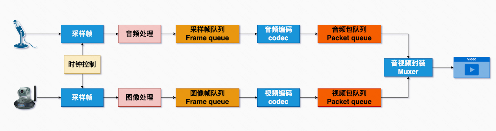

首先，大家通常说的视频文件，往往包括的画面和音频，画面由摄像头采集，音频由麦克风采集。而音画是需要同步采集的，但音频采样的频率会比画面采样频率高出很多，所以在采样时会按时钟进行控制，从而达到同步的效果，音画在采样后会分别形成采样帧，这是一个模拟信号转数字信号的过程。

然后视频画面依次经过**图像处理**、视频编码后会形成**视频包队列**（也称之为”视频码流“），而声音则依次经过音频处理、音频编码，形成音频码流，最后经过**封装**，就会形成一个**视频文件**。

不难看出画面和声音其实是两个不同的制作流程，由于篇幅关系，今天只聊画面部分的制作流程。

## Part 1 从拍摄设备到采样帧

### 什么是成像？

视频拍摄的过程可以理解为相机按一定的频率进行拍照，形成一幅幅连续的画面。而拍照时，相机会负责将显示中的光信号转为计算机能够处理的数字信号，这个处理过程称之为“成像”。显然，成像是从拍摄设备到采样帧过程中最重要的一步。

### 相机成像原理

#### 理论基础

在开始相机成像原理之前，需要回顾一个初中物理小知识 ：光是具有沿直线光具有沿直线传播的性质，例如用一个带有小孔的板遮挡在墙体与物之间，墙体上就会形成物的倒影， 前后移动中间的板，墙体上倒影的大小也会随之发生变化，这就是小孔成像原理。

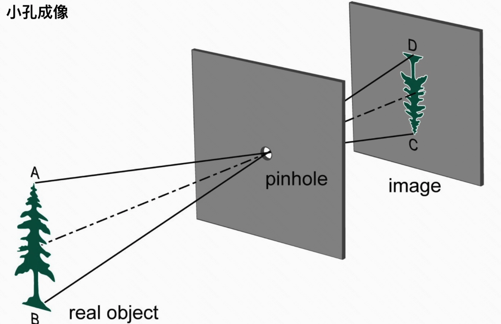

#### 相机结构

相机正是基于 **小孔成像** 原理来进行工作的，下图是一个相机的基本组成结构：

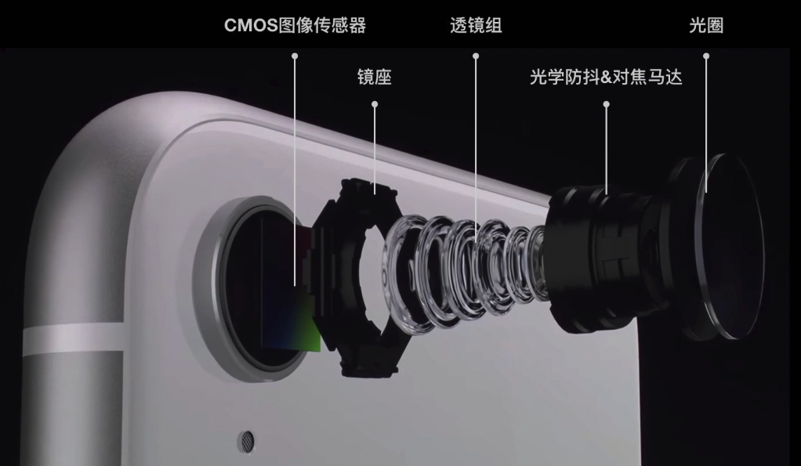

- 位于相机最底部的是CMOS图像传感器，可以理解为小孔成像中的墙，负责感知光线
- 其次是镜座 用于固定相机模块
- 再然后是透镜组，可以理解为小孔成像中的“孔”，负责收束光线
- 在上一层是光学防抖和对焦马达， 他能够让透镜组随着当前环境处于相对CMOS的合适位置和距离，从而尽可能稳定的成像
- 光圈位于最外层，用于控制透镜组能够收束光线的范围

依据小孔成像，不难看出这里面最重要的元件就是透镜组和CMOS图像传感器，接下来就了解下这两个重要的元件是如何配合从而搞定成像的?

#### 透镜组

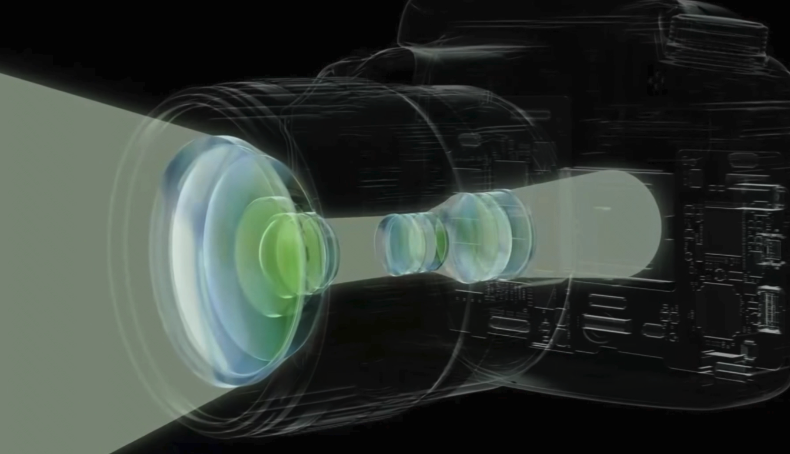

透镜组通常由一组凸透镜和一组凹透镜构成，其中凸透镜组汇聚外部光线，凹透镜将这些光线均匀的发散到底部的CMOS传感器上，使得CMOS能够尽可能多得获取拍摄画面的细节。

凸透镜组和凹透镜组之间的距离能够控制拍摄时的进光数量。光线数量越多，画面也就越广、越丰富。光线数量越少，画面也就越窄、表现在图片上会越细腻。

事实上，这个镜组之间的距离其实就是大家拍照时经常调整的参数“焦距“， 这也是为什么短焦距能拍出广角照片、长焦距能拍出远景的原因。

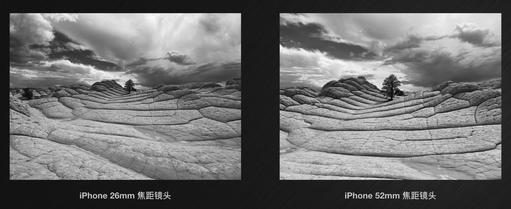

以上就是相机中透镜组和结构和成像中的作用，“小孔”部分完结之后，再来“墙”的部分

#### CMOS图像传感器

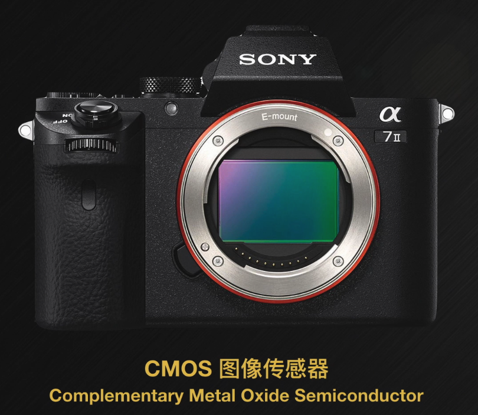

CMOS图像传感器负责捕获到来自透镜组的光信号，并将光信号转化为图像数字信号交由计算机处理，也就是说它的主要工作是捕获和转化。

但是在捕获过程中存在一个问题：CMOS只能获取到光线的强度，无法理解光线的颜色的，也就是说这种情况下CMOS只能通过光的强度还原出一副黑白照片。

为了获取彩色图像，CMOS传感器每个像素上方会铺设一层“拜耳滤镜”，形成一个拜耳滤镜阵列。 拜耳滤镜阵列由三种不同颜色的滤镜构成，这种滤镜的特点是只允许相同的颜色通过。通过这个方法，相当于CMOS上的每个像素点都被滤镜定义了属于自己的颜色。

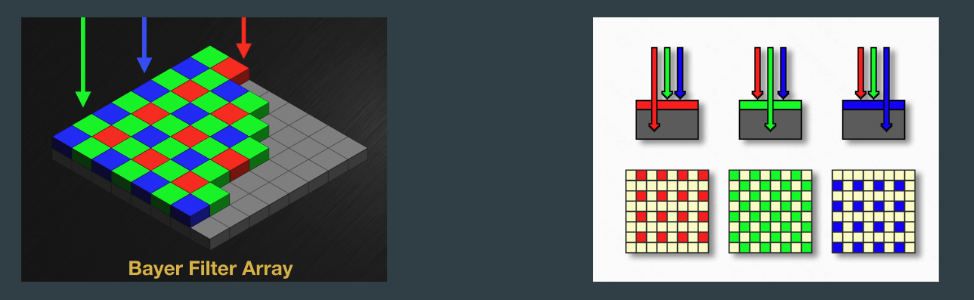

最后CMOS会把这些光数据和Bayer滤镜数据传送给图像处理器（ISP），经过ISP一阵操作之后，就会能得到一个彩色图像数据，这个数据就是视频画面需要的采样帧，且每个像素都通过RGB色彩编码有自己准确的颜色值。

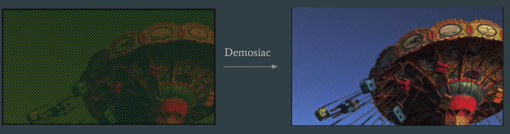

至此，这段视频的的取经之路第一步就走完了。

### 取经之路 - 通关文牒

还记得上面有提到，这个彩色图像中，每个像素都通过RGB进行色彩编码。但是，RGB有一个问题：数据占用大。例如一幅尺寸为1920 \* 1080像素、位深为8bit的图像，体积会达到1920 \* 1080 \* (3\*8bit)，约为6.22MB左右。这个大小在视频领域是非常可怕的，例如每秒30帧的视频， 数据处理量将会达到186MB/s。

所以还需要进一步对图像进行处理...

## Part 2 从采样帧到图像处理

为了解决RGB编码数据占用过大的问题，这一步主要工作内容其实就是将RGB换成了另一种压缩率更高的编码 - YUV。

### 什么是YUV？

YUV是一种不同于RGB的颜色编码，Y 表示亮度，U表示蓝色色度(Cb)， V表示红色色度(Cb)。U+V的组合能够形成一个没有亮度的颜色，这个颜色也就是U+V的组合称为色度。

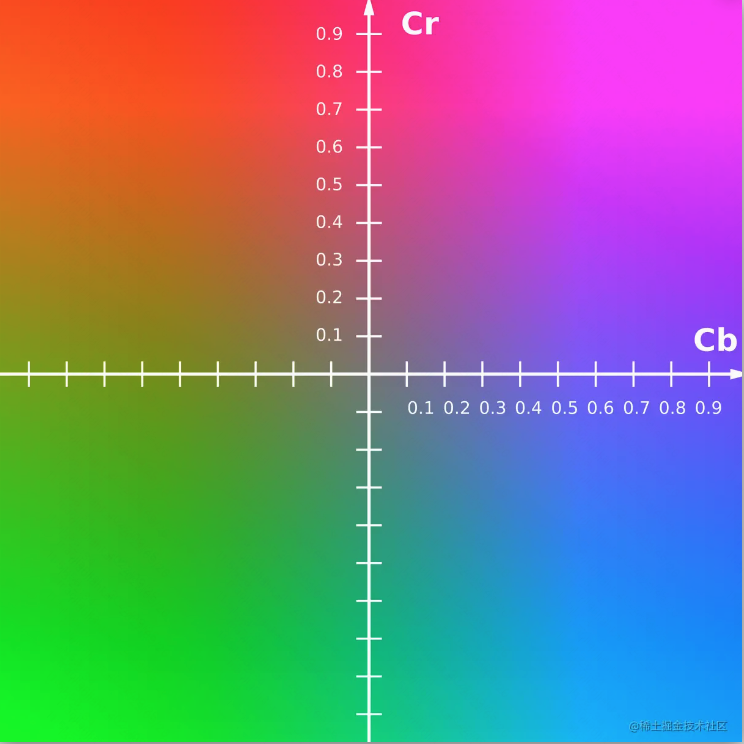

不难看出YUV和RGB一样，都具有三个通道构成，在位深一样的情况下YUV是怎么做到比RGB的数据占用更小的呢？

在解释这个问题之前，要先了解一个关于眼睛感知的研究结论：人的感观对于亮度信息的敏感度要远高于对色度信息的敏感度

在这个结论的基础下，**YUV可以适当降度色度的数据占比，并保证图像对人体感观不会造成太大的影响**。

一般情况下YUV按照色度与亮度数据占比的不同，可以分为下面三种类型：

- 4:4:4: 每个具有亮度的像素都有自己的独占的色度 （ 数据占用 = RGB）
- 4:2:2: 每2个具有亮度的像素共用1个色度 （ 数据占用 = ⅔ RGB）
- 4:2:0: 每4个具有亮度的像素共用1个色度 （ 数据占用 = ½ RGB）

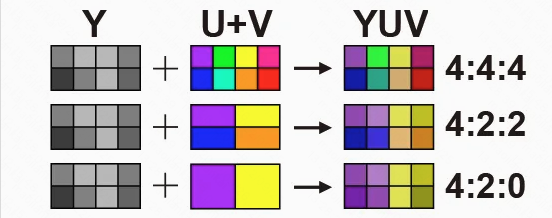

在极大的压缩色度信息的数据占用后，由于人眼的视觉敏感度的特性，整个图像并不会有打开的差异。采用YUV编码后，YUV4:2:0仅为RGB编码数据体积的½， 且YUV只需要把色度去除就可以完美兼容黑白显示设备。

### YUV在图像处理中角色

由于采集到的图像帧为RGB编码，因此需要在图像处理这一步，将RGB编码转换为YUV编码，而且，由于显示器也只能识别RGB编码，所以在实际播放中视频的过程中，还需要进一步将YUV编码转为RGB才能被正确播放。没错，YUV这视频中，其实充当的是中间编码的作用，旨在使视频画面能够的数据能比RGB编码有所下降。

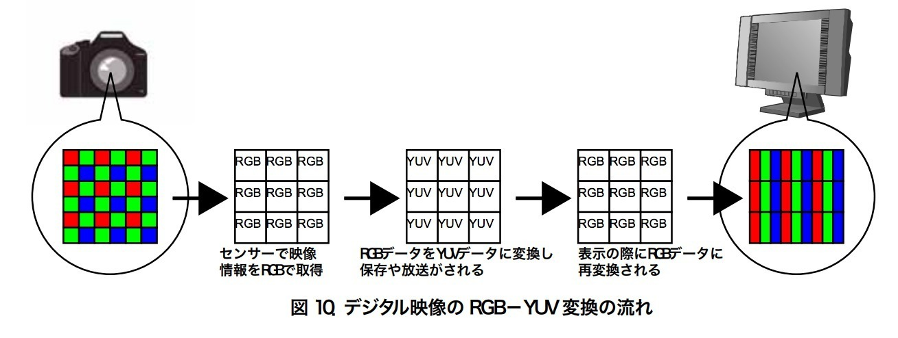

至此，图像处理的工作就结束了，但是取经之路还在继续...

### 取经之路 - 通关文牒

例如一个1920\*1080尺寸60fps的视频，即使通过YUV4:2:0色彩编码，它每秒的数据量约178Mb，仍然非常庞大，所以视频还需要进一步处理！

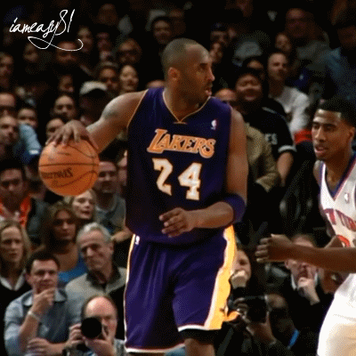

## Part 3 从图像帧队列到视频编码

### 什么是视频编码？

除了图像编码能够带来数据减少之外，视频中的图像帧队列其实还可以从方面进行压缩，这种压缩压缩的过程，称之为“视频编码”，通常一些视频厂商都有自己的一套视频编码方案，从而形成一种固定的范式，这就是“编码格式”

现实中常见的编码格式也很多，比如：

- H.264 最常见，压缩率一般，浏览器支持较好
- H.265 通常仅在视频平台才能见到, 压缩率很高，但收费
- VP9 谷歌自研，压缩率和H265几乎一致，免费。但是由于代码和H.265过于相似，各大厂商为了规避版权问题，不敢使用

### 视频编码的依据

压缩的主要依据是由于视频中存在四种类型的冗余：

1. 帧间冗余 (视频文件会有、GIF文件会有)
2. 帧内冗余 (图片文件会有、视频由于由画面构成，而每个画面里会有帧内冗余)
3. 感知冗余 (图片文件、音频文件会有)
4. 编码冗余 (所有文件都有)

针对不同类型的冗余信息，在各个视频编码的标准算法中都有专门的技术来应对，从而通过不同的角度来提高压缩比：

1. 运动估计和运动补偿 -> 帧间冗余
2. 变换编码 -> 帧内冗余、感知冗余
3. 熵编码 -> 编码冗余

由于篇幅关系，今天重点聊聊帧间冗余的技术。

### 什么是帧间冗余？

图像帧队列中，连续的帧间往往有着大量的相同信息，主要区别就是帧内人物的运动。如图，除了字幕外，这两帧画面中，只有洪世贤的眼睛和嘴巴有细微的变化，其余的画面部分都是重复的。这种连续帧之间重复出现的画面信息称之为帧间冗余。

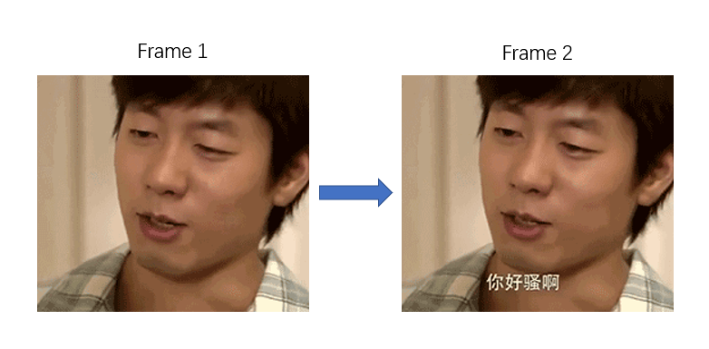

这种情况下视频没有必要对每一帧图像单独进行编码存储，只需要对相邻画面中发生变化的部分编码即可，这方面的工作是由运动估计和运动补偿来实现的 。

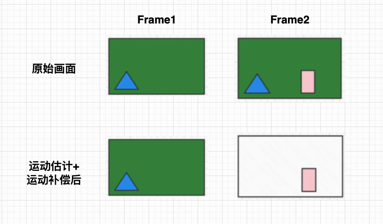

### 运动估计和运动补偿

运动估计简单来说就是搜索当前帧与参照帧相同的部分，它的工作机制是将当前帧分割成若干个不重叠的小图像子块（宏块），然后在参考帧某个范围内搜索最相似的宏块。

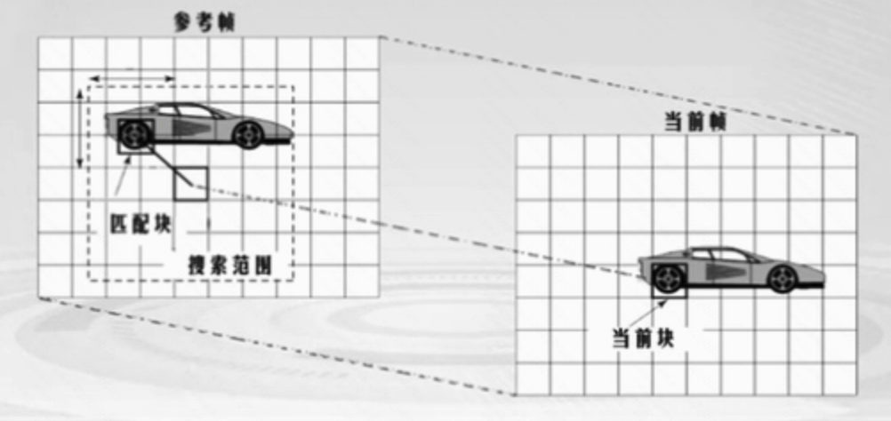

当前帧中的宏块运动估计成功后，会与参考帧中的匹配块进行像素级相减，得到一个残差宏块，由于残差宏块中缺失了大量相似像素，所以极大的减少了当前帧的数据量，而这个相减过程叫运动补偿。

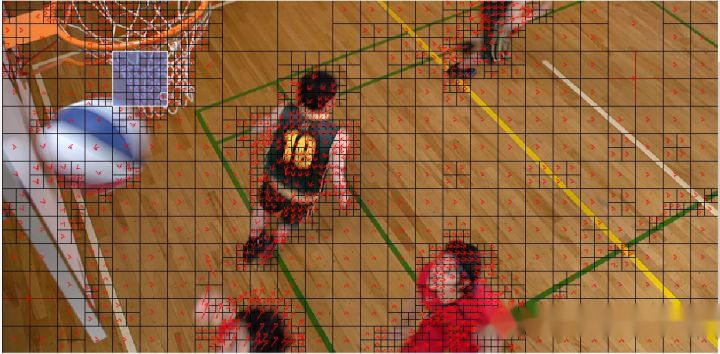

### 编码器是如何寻找参考帧的？

运动估计和运动补偿的操作都需要寻找一个参考帧才可以进行工作。因此编码过程中会把当前帧按参考帧寻找方式的不同，分为3种类型：

- I帧 (关键帧)
- P帧 (前向预测帧)
- B帧 (双向预测帧)

I 帧会包含完整的图像信息，因此他不需要参考帧，通常作为其他帧的参考帧， 他没有什么压缩空间。P帧以 前面的I、P帧作为参考帧。B帧以 前面的I、P帧 和 后面的I、P帧 作为参考帧，由于前后分别参照了两帧，会减少大量的相似宏块，所以它的压缩率是最高的。

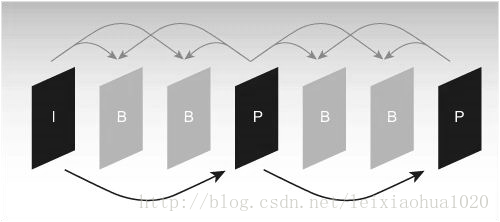

在编码阶段确定好每种帧的类型之后，解码时，解码器就可以按照不同的帧类型去寻找对应的参考帧，从而进行图像的反解。

### B帧存在的问题

由于B帧依赖了后面的帧作为参照帧，这样就会存在1个问题 ：在视频流中一般是边播放、边解码的，当解码到 B 帧时，需要等待它依赖的后面的 I、P 帧先解码完成，这样一来整个解码器就没有办法立即完成B帧的解码，导致视频无法继续播放。

为了解决这个问题，编码阶段，编码器为每一帧生成两种时间戳：

- DTS（解码时间戳)：告诉播放器该在什么时候解码这一帧的数据
- PTS（显示时间戳)：告诉播放器该在什么时候显示这一帧的数据

有了DTS和PTS后，解码器就能够在B帧来临前就准备好后面的参照帧，使B帧在规定的时间点被解码。

### 边界Case：参照帧损坏

当参照帧出现损坏时，所有依赖这个帧的P、B帧都将被错误的解码，这种情况下有可能出现整个视频都无法播放或者花屏的情况，那么这个问题该如何解决呢？

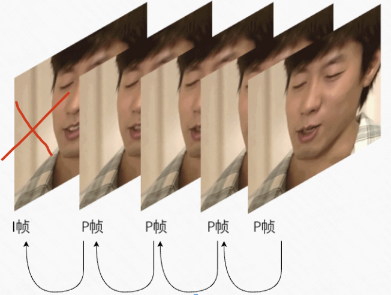

不同的编码格式解决的方式可能不太一样，这里主要来看看最广泛的H264是如何因对的：H.264编码的方案是将图像帧队列，按画面的连续性划分为一段段序列，每个序列的第一帧是I帧。当解码到这个I帧时，会立即将参考帧队列清空，将已解码的数据全部输出或抛弃，开始一个新的序列。将这类特殊的I帧称为IDR帧，而这个序列被称之为GOP。

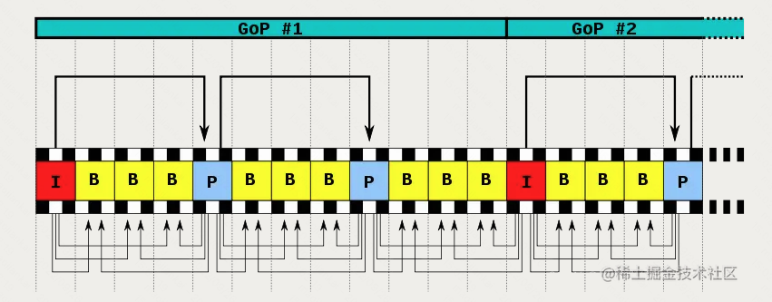

### 变换编码和熵编码

视频编码中，也为图像画面用上了和JPEG等图像压缩标准类似的变换编码（DTC变换）和熵编码从而进一步减少数据量。由于篇幅关系，这里不再展开这两类算法。

为了更好的理解这几种编码和算法的关系，接下来来看看这几种算法是如何在视频编码器里按“混合编码模型”工作的 ？

### 混合编码模型

当前输入的图像首先要经过分块，分块得到的图像块要与在帧存储起中已经编码过参照帧进行运动估计和运动补偿后产生差值图像，然后对该差值图像块进行DCT变换和量化。

如果当前帧不会被作为参照帧，那么就会送熵编码器进行编码，然后保存到缓存器中，等待传送给封装器。

如果这个帧会被作为参照帧，那么会进行反量化和反变化，完成还原后，送到帧存储器了，供其他帧参照。

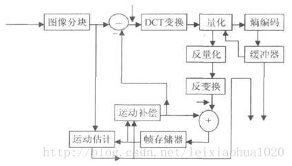

此时，取经之路的第三步也就顺利完结了，但是此时离最终的视频文件还需要走一步 💡

### 取经之路 - 通关文牒

经过视频编码后，生成了一段段压缩率非常高的数据包队列Packet queue（或码流），此时可能还有音频编码也完成了，而这些不同类型的码流正迫切需要一个容器来统一存放...

## Part 4 从视频编码到音视频封装

### 什么是封装？

封装格式的主要作用正是把视频码流和音频码流以及一些元数据（例如文件大小、编码类型、分辨率、字幕、创作时间等等）按照一定的规范存储在一个文件中。

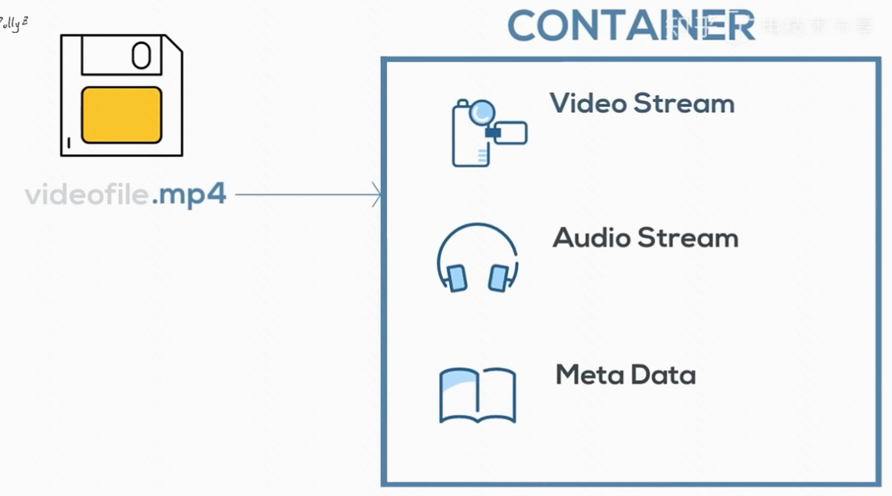

### 主流封装格式

目前市面上有需要不同类型的封装格式，但它们所支持的视频编码格式和音频编码格式可能会有些许不同：

### MP4

MP4是网络中传播最广泛的封装格式之一。全称为 MPEG-4 Part 14，

- 视频编码格式：H.264，H.265，MPEG4、 VP9等
- 音频编码格式：MP3, AAC 等

### MOV

MOV 是随着苹果公司开发的 QuickTime Player 一起推出的，因此用 Mac 自带录屏软件录制或者手机拍摄的视频其格式都是 mov 。

- 视频编码格式：H.264、H.265、MPEG4等
- 音频编码格式：AAC 等。

### AVI

AVI： Audio Video Interleave，由微软推出，用于对抗苹果 Quicktime 的技术。AVI分装格式下，会生成一个索引码流的索引，这个索引被放在了文件的最后面，这也就导致AVI不利于流式播放，需要将整个文件都就绪后再能进行播放。

- 视频编码格式：MPEG-4，H.264/MPEG-4 AVC，FLV, VC-1等，
- 音频编码格式：PCM, MP3, AAC, WMA等

## 最后

最终在不同的封装格式下，生成了不同后缀的多媒体文件。至此，这段视频的取经之路也顺利完结，可能会被分发到网络上被家家户户观看。同时也可以随手找一些视频文件看看它们的编码、封装格式，能找到取经路上的足迹。

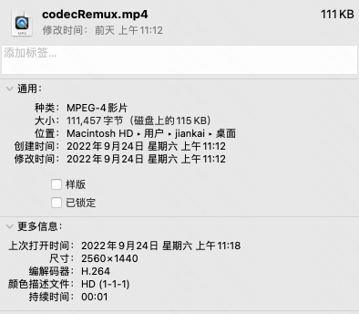

不难看出，不论是图像处理还是视频编码，其实就是在不断的减少视频占用的体积。目前，随着压缩率高的视频编码推出，大家已经可以在网页中能看到就能画质越来越高的视频（4K、8K）等。

不过，在网页场景中，浏览器往往默认仅支持少量的音视频编码。像那些压缩率比较高的编码，需要开发者发者自行去进行编解码，然后通过Canvas等其他手段去播放，浏览器也提供了相关的API，例如WebCodecs。如果大家想要自己去写一个编解码器，可以尝试用这组API（逃）。

## 参考资料

- [https://blog.csdn.net/leixiaohua1020/article/details/28114081](https://blog.csdn.net/leixiaohua1020/article/details/28114081)
- [https://blog.csdn.net/leixiaohua1020/article/details/18893769](https://blog.csdn.net/leixiaohua1020/article/details/18893769)
- [https://www.bilibili.com/video/BV1rK4y1C7bQ](https://www.bilibili.com/video/BV1rK4y1C7bQ)
- [https://codeantenna.com/a/E8LfDOqIlP](https://codeantenna.com/a/E8LfDOqIlP)
- [https://xie.infoq.cn/article/e63fd59c1c9e7f23cadcb4c10](https://xie.infoq.cn/article/e63fd59c1c9e7f23cadcb4c10)
- [https://zhuanlan.zhihu.com/p/503942575](https://zhuanlan.zhihu.com/p/503942575)
- [https://cloud.tencent.com/developer/news/739759](https://cloud.tencent.com/developer/news/739759)
- [https://juejin.cn/post/7081936943025487903](https://juejin.cn/post/7081936943025487903)
- [https://zhuanlan.zhihu.com/p/67305755](https://zhuanlan.zhihu.com/p/67305755)
